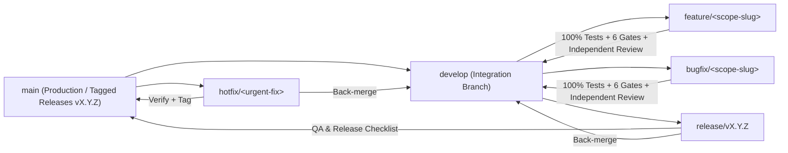

# Professional Git Flow & Proactive User Recommendation Playbook

This reference defines the **Professional Git Flow** standard and the **Proactive Git Flow Recommendation Protocol** integrated into `akit-git`, `akit-router`, and `akit-deliver`.

---

## 1. Proactive Git Flow Recommendation Protocol (`Recommend to User`)

Whenever a user initiates a new project, starts a non-trivial feature/bugfix on `main`/`master`, or asks to organize their repository workflow:
1. **Inspect Current Git State (`run_command`):**
   - Check `git branch --show-current`, `git status --short`, and `git branch -a`.
2. **Proactively Ask & Recommend Professional Git Flow (`ask_question` or Direct Recommendation):**
   - If the user is currently working directly on `main` / `master` or has not selected a branching workflow, **proactively recommend Professional Git Flow** using `ask_question`:
     - **Option 1 (Recommended):** *"Áp dụng Git Flow chuyên nghiệp (Tạo nhánh riêng `feature/<tên>` hoặc `bugfix/<tên>`, commit theo chuẩn Conventional Commits, chạy đủ 6 cổng kiểm định + 100% test pass trước khi merge/PR về `develop`/`main`)."*
     - **Option 2:** *"GitHub Flow gọn nhẹ (Tạo nhánh `feature/<tên>` trực tiếp từ `main`, kiểm định 100% test pass rồi merge/PR về `main`)."*
     - **Option 3:** *"Làm việc trực tiếp trên nhánh hiện tại (chỉ áp dụng Conventional Commits và cổng kiểm định trước khi commit)."*

---

## 2. Professional Git Flow Branching Model

### Branch Naming & Purpose Table

| Branch Type | Naming Pattern | Branched From | Merged Back Into | Purpose & Rules |
| :--- | :--- | :--- | :--- | :--- |
| **Production** | `main` (or `master`) | — | — | Always deployable, 100% green tests, tagged with semantic versions (`v0.4.0`, `v1.0.0`). Direct unreviewed commits are forbidden. |
| **Integration** | `develop` | `main` | `release/*` $\rightarrow$ `main` | Integration branch for completed features and bugfixes (in full Git Flow). |
| **Feature** | `feature/<ticket-or-slug>` | `develop` (or `main` in GitHub Flow) | `develop` (or `main`) | New features or enhancements. Isolated per task (or in `.worktrees/feature-<slug>`). |
| **Bugfix** | `bugfix/<ticket-or-slug>` | `develop` | `develop` | Non-emergency defect fixes with mandatory TDD regression test. |
| **Release** | `release/vX.Y.Z` | `develop` | `main` & `develop` | Version bump, changelog, final E2E/release verification (`akit-deliver`), no new features. |
| **Hotfix** | `hotfix/<ticket-or-slug>` | `main` | `main` & `develop` | Critical production bugfix; requires immediate regression test + independent review. |

---

## 3. Conventional Commits & Atomic Commit Discipline

Every commit in a Professional Git Flow repository MUST follow **Conventional Commits (`<type>(<scope>): <imperative summary>`)**:
- `feat(transactions): add cross-tenant ownership check and atomic balance update`
- `fix(wallets): prevent concurrent overdraft via conditional update`
- `test(transactions): add User A vs User B cross-account isolation tests`
- `refactor(budgets): simplify period state guard clauses`
- `docs(api): document problem-details error codes for wallet endpoints`
- `chore(lint): enforce @typescript-eslint/no-explicit-any error gate`

### Pre-Commit & Pre-Merge Hard Gate
Before creating a commit or merging a `feature/*` / `bugfix/*` / `hotfix/*` branch:
1. `typecheck` passes (`exit_code == 0`, zero unapproved `any`).
2. `lint` passes (`exit_code == 0`).
3. `test` suite achieves **100% pass rate** (`0 failed`, `0 errors`, including cross-tenant & business invariant tests).
4. `independent review` (`akit-critic` / `akit-security`) is `APPROVED`.
5. `git diff --check` confirms zero conflict markers or whitespace corruption, and `.env` / secrets are excluded.
