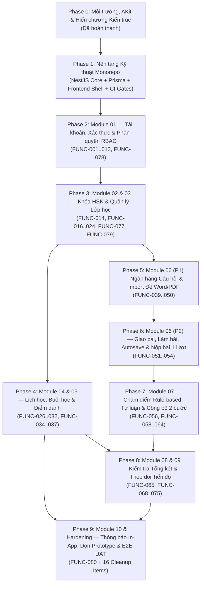

# KẾ HOẠCH TỔNG THỂ DỰ ÁN WEBEDU — TRUNG TÂM TD HÁN NGỮ (MASTER IMPLEMENTATION PLAN)

> **Execution Mode:** Kiến trúc phân cấp **Master Plan $\rightarrow$ Phase Sub-Plans (`docs/plans/phase-XX-<slug>.md`)** thực thi theo phương pháp **Vertical Slice TDD (`RED -> GREEN -> REFACTOR`)** và **Subagent-Driven Development (SDD)** (`akit-plan`, `akit-implement`).

- **Goal:** Xây dựng hoàn chỉnh hệ thống Quản lý lớp học và học tập trực tuyến cho Trung tâm TD Hán Ngữ (WebEdu Phase 1) bao phủ 10 nhóm module nghiệp vụ, đảm bảo phân quyền chặt chẽ cấp Server-side, bảo toàn 100% lịch sử học tập và tuân thủ 6 Cổng Kỹ Thuật AKit.
- **Architecture:** Modular Monolith (`backend/` với NestJS 12 + Prisma ORM 6 + PostgreSQL 16+; `frontend/` với React 19 / Next.js 16 App Router + Tailwind CSS v4 theo định hướng xanh lá tối giản Á Đông).
- **Tech Stack:** TypeScript (`"strict": true`, cấm `any`), NestJS, Prisma ORM (kỷ luật SQL Migration, cấm `prisma db push`), PostgreSQL 16+, Vitest + Supertest (Unit/Integration/E2E), Playwright (Browser QA), `date-fns` / `date-fns-tz` (neo múi giờ `Asia/Ho_Chi_Minh`). *(Lưu ý đồng bộ: `backend/` dùng Vitest thay cho Jest kế hoạch ban đầu.)*
- **Binding Specs & Authority Order:**
  1. Quyết định mới nhất của người phụ trách dự án
  2. [`decision-log.md`](file:///c:/Users/ASUS/Desktop/WebEdu/TD_Han_Ngu_Project_Context_v1.0/docs/01-business/decision-log.md) & [`open-issues.md`](file:///c:/Users/ASUS/Desktop/WebEdu/TD_Han_Ngu_Project_Context_v1.0/docs/01-business/open-issues.md)
  3. [`architecture-decision-contract.md`](file:///c:/Users/ASUS/Desktop/WebEdu/TD_Han_Ngu_Project_Context_v1.0/docs/03-technical/architecture-decision-contract.md) (Triad Debate Contract)
  4. Đặc tả 10 module tại [`docs/02-requirements/modules/`](file:///c:/Users/ASUS/Desktop/WebEdu/TD_Han_Ngu_Project_Context_v1.0/docs/02-requirements/modules/) & [`business-rules.md`](file:///c:/Users/ASUS/Desktop/WebEdu/TD_Han_Ngu_Project_Context_v1.0/docs/01-business/business-rules.md)
  5. [`prototype-review.md`](file:///c:/Users/ASUS/Desktop/WebEdu/TD_Han_Ngu_Project_Context_v1.0/docs/02-requirements/prototype-review.md) (Tham chiếu UI và lọc bỏ 16 thành phần demo)
- **Explicit Non-Goals (Out-of-Scope Phase 1):**
  - Website marketing, landing page tuyển sinh, form thu thập lead.
  - Tài khoản phụ huynh riêng biệt (phụ huynh dùng chung luồng hỗ trợ đăng ký của học viên < 16 tuổi).
  - Thu học phí / thanh toán trực tuyến (`BR-02`).
  - AI/LLM chấm bài tự luận mở (`FUNC-057` — Loại bỏ).
  - Nhập điểm bài kiểm tra trên giấy thủ công (`FUNC-076` — Loại bỏ).
  - Gửi thông báo nghiệp vụ qua Zalo / Email marketing (`DEC-015` — Chỉ làm thông báo In-App).
  - Tóm tắt buổi học (`SCOPE-01` — Không triển khai trừ khi có yêu cầu thay đổi).

---

## 1. Sơ Đồ Kiến Trúc Lộ Trình & Phụ Thuộc Giữa Các Giai Đoạn (Phase Dependency Graph)

---

## 2. Cơ Chế Sinh Kế Hoạch Con (Sub-Plan Generation Protocol)

Mỗi khi bắt đầu một Phase (từ Phase 1 đến Phase 9), chúng ta **không code ngay** mà thực hiện quy trình 4 bước để sinh **Kế hoạch con (`docs/plans/phase-XX-<slug>.md`)**:

1. **Bước 1 — Giải quyết Cổng Open Issues của Phase (`Gate Resolution`):**
   - Chỉ hỏi và chốt các mục `BLOCKS` / `DEFERRED` thuộc đúng Phase đó (ví dụ: chốt `AUTH-01..04` đầu Phase 2; chốt `ATT-01` đầu Phase 4; chốt `GRADE-01` đầu Phase 7). Các mục của Phase sau tiếp tục giữ `TBD-DEFERRED` để không làm nghẽn tiến độ.
2. **Bước 2 — Khảo sát Prior-Art nếu có tính năng kỹ thuật phức tạp (`akit-prior-art`):**
   - Áp dụng cho Phase 5 (Parser chuyển đổi đề Word/PDF sang câu hỏi tương tác `FUNC-040/041`) và Phase 6 (Trình phát Audio/Drag-and-drop sắp xếp câu Hán ngữ `FUNC-047/049`).
3. **Bước 3 — Lập Sub-Plan Chia Nhỏ Theo Vertical Slices (`akit-plan`):**
   - Mỗi Sub-plan gồm 4–8 Tasks nhỏ, mỗi Task cắt dọc từ: **Migration/Schema $\rightarrow$ DTO/Service/Controller $\rightarrow$ Unit & IDOR Test $\rightarrow$ Frontend UI Component $\rightarrow$ Browser Verification**.
   - Ghi rõ bảng `Consumes` / `Produces` và chạy `Pre-flight Conflict Scan` trước khi code Task đầu tiên.
4. **Bước 4 — Nghiệm thu Đóng Phase (`Phase Exit Gate`):**
   - Chạy đủ 4 lệnh kiểm chứng (`typecheck`, `lint`, `test`, `test:e2e`), review độc lập qua `akit-critic` & `akit-security`, cập nhật `PROJECT_PROGRESS.md`.

---

## 3. Chi Tiết 10 Giai Đoạn Triển Khai (Phases 0 $\rightarrow$ 9)

### Phase 0: Thiết Lập Môi Trường, AKit & Hiến Chương Kiến Trúc *(ĐÃ HOÀN THÀNH)*
- **Mục tiêu:** Khởi tạo Git repository, tích hợp bộ công cụ AKit v0.4.0, nạp ngữ cảnh dự án TD Hán Ngữ v1.0, tổ chức Triad Debate giữa 3 subagents và ban hành Hiến chương Kiến trúc.
- **Trạng thái:** `COMPLETED (100%)`
- **Deliverables đã nghiệm thu:**
  - [x] Khởi tạo Git repo `WebEdu`, `.gitignore`, `README.md`, `PROJECT_PROGRESS.md`.
  - [x] Cài đặt 30 AKit Skills (`.agents/skills/`), 6 Subagents (`.agents/agents/`), Runtime CLI (`.akit/runtime/`), Rules (`GEMINI.md`, `.agents/rules/akit.md`).
  - [x] Khắc phục lỗi Windows hook runner và xác minh `doctor --strict` (`ok: true`, `30 skills`).
  - [x] Ban hành [`architecture-decision-contract.md`](file:///c:/Users/ASUS/Desktop/WebEdu/TD_Han_Ngu_Project_Context_v1.0/docs/03-technical/architecture-decision-contract.md).

---

### Phase 1: Khởi Tạo Nền Tảng Kỹ Thuật Fullstack (Foundation & Monorepo Bootstrap) *(ĐÃ HOÀN THÀNH — MERGED `develop`)*
- **File Sub-Plan:** [`docs/plans/phase-01-foundation-bootstrap.md`](./docs/plans/phase-01-foundation-bootstrap.md)
- **Mục tiêu:** Dựng bộ khung thực thi chuẩn cho cả `backend/` (NestJS + Prisma + PostgreSQL) và `frontend/` (Next.js/React + Tailwind CSS + Design Tokens), thiết lập cổng kiểm thử tự động.
- **Open Issues:** `SYS-01` **ĐÃ CHỐT** (Next.js 16 App Router + PostgreSQL 16 Docker Compose + `uploads/` local có magic-bytes gate).
- **Interfaces (`Consumes` / `Produces`):**
  - **Consumes:** Quy chuẩn từ `architecture-decision-contract.md`.
  - **Produces (thực tế):**
    - `backend/src/common/prisma/prisma.service.ts` (`PrismaService` quản lý kết nối DB)
    - `backend/src/common/filters/all-exceptions.filter.ts` (Chuẩn hóa lỗi RFC 7807 `type`, `title`, `status`, `detail`, `instance`, `timestamp`, `invalidParams?`; *không sinh `requestId`*)
    - `backend/src/common/http/configure-app.util.ts` (Global `ValidationPipe` với `whitelist: true, forbidNonWhitelisted: true, transform: true`, `helmet`, giới hạn JSON `100kb` + `4mb` cho `/system-settings/config`)
    - `backend/src/common/utils/timezone.util.ts` (Helper múi giờ `Asia/Ho_Chi_Minh`)
    - Endpoint `GET /api/v1/health` và Swagger UI tại `/api/docs` (non-production)
    - `frontend/` khung layout cơ bản theo định hướng xanh lá tối giản, loại bỏ thanh "Prototype · Xem với vai trò" (**Cleanup #1**) và nhãn "FUNC-xxx" (**Cleanup #6, #7, #8**).
- **Các Vertical Slice Tasks trong Sub-Plan Phase 1:**
  - [x] **Task 1.1:** Khởi tạo `backend/` NestJS (Strict TS, OxLint cấm `any`), cấu hình `@nestjs/config` với schema validation (`.env.example`).
  - [x] **Task 1.2:** Thiết lập `docker-compose.yml` (PostgreSQL 16) + khởi tạo Prisma ORM (`prisma/schema.prisma`) với bảng `SystemSetting` (`system_settings`) & `SystemAuditLog` (`system_audit_logs`).
  - [x] **Task 1.3:** Xây dựng Global `ValidationPipe`, `AllExceptionsFilter`, CORS, prefix `/api/v1`, Swagger `/api/docs` và `GET /api/v1/health` (kèm Unit + E2E test).
  - [x] **Task 1.4:** Xây dựng tiện ích thời gian `timezone.util.ts` (`Asia/Ho_Chi_Minh`) kèm bộ unit test kiểm chứng chuyển đổi UTC $\leftrightarrow$ GMT+7.
  - [x] **Task 1.5:** Khởi tạo `frontend/` (React 19 / Next.js 16 + Tailwind CSS v4), thiết lập Design System tokens (`DESIGN.md`), API Client chuẩn và Shell layout phân rã (`PortalShell`, `PortalSidebar`, `PortalTopbar`, `MobileNavDrawer`).

---

### Phase 2: Module 01 — Tài Khoản, Xác Thực & Phân Quyền (Auth, Users & RBAC) *(ĐÃ HOÀN THÀNH — MERGED `develop`, CÒN DRIFT NHỎ `TD-07..10`)*
- **File Sub-Plan:** [`docs/plans/phase-02-auth-users-rbac.md`](./docs/plans/phase-02-auth-users-rbac.md)
- **Phạm vi Mã Chức Năng (14 FUNCs):**
  - `Phase 1 (10)`: `FUNC-001` (HV tự đăng ký, $\ge 12$ tuổi), `FUNC-002` (Đồng ý của cha mẹ qua **Email phụ huynh** cho HV $< 16$ tuổi — `DEC-001`), `FUNC-003` (Đăng nhập, khóa 15 phút khi sai 5 lần), `FUNC-004` (Đăng xuất), `FUNC-005` (Khôi phục mật khẩu qua email — `DEC-016`), `FUNC-009` (Một người dùng nhiều vai trò, quyền hợp nhất đa vai trò — `DEC-020`), `FUNC-010` (HV chỉ xem dữ liệu mình), `FUNC-011` (GV chỉ truy cập lớp được giao), `FUNC-012` (Admin xem tất cả lớp), `FUNC-013` (Superadmin vận hành hệ thống & cấu hình tên trung tâm/logo).
  - `Dự kiến P1 (4)`: `FUNC-006` (Quản lý tài khoản GV), `FUNC-007` (Quản lý thông tin HV), `FUNC-008` (Liên kết tài khoản với hồ sơ và xếp lớp), `FUNC-078` (Hồ sơ cá nhân & đổi mật khẩu).
- **Open Issues Gate (`AUTH-01..04`):** **ĐÃ CHỐT (`RESOLVED`)** tại `open-issues.md` & `DEC-023`.
- **Prototype Cleanup áp dụng tại Phase 2:**
  - Loại bỏ khối "Tài khoản demo" ở màn Đăng nhập (**Cleanup #2**).
  - Loại bỏ dòng gợi ý "Thử lỗi" ở màn Đăng nhập & Đăng ký (**Cleanup #3**).
  - Loại bỏ checkbox "Xem như tài khoản Chờ xếp lớp" (**Cleanup #4**).
  - Giữ cột "Đồng ý cha mẹ" (`Đã xác nhận` / `Không áp dụng`) nhưng bỏ giá trị `Thiếu` (**Cleanup #12**).
  - Loại bỏ trường "Đăng ký lúc" trong Hồ sơ học viên (**Cleanup #13**).
  - Loại bỏ trường "Múi giờ" trong Cấu hình hệ thống của Superadmin (**Cleanup #15**).
  - Giữ tag "Admin" cạnh tên GV kiêm nhiệm trong Danh sách giáo viên (**Cleanup #16**).
- **Interfaces (`Consumes` / `Produces` thực tế):**
  - **Consumes:** `PrismaService`, `AllExceptionsFilter`, `ValidationPipe` từ Phase 1.
  - **Produces:**
    - Models: `User`, `StudentProfile`, `TeacherProfile`, `GuardianConsent`, `PasswordResetToken`, `SystemSetting`, `EmailVerification`, `EmailRateLimit`, `AuthRateLimit`.
    - Guards & Decorators: `JwtAuthGuard`, `RolesGuard`, `@CurrentUser()`, `@Roles()`, `@Public()`, `@AuthenticatedOnly()`, `role-hierarchy.util.ts` (đa vai trò `FUNC-009`).
    - APIs: `/api/v1/auth/*`, `/api/v1/profile/*`, `/api/v1/students/*`, `/api/v1/teachers/*`, `/api/v1/system-settings/*`.
- **Các Vertical Slice Tasks trong Sub-Plan Phase 2:**
  - [x] **Task 2.1:** Thiết kế Prisma schema & migration cho `User`, `Role[]`, `GuardianConsent`, `AuthRateLimit` / `EmailVerification` (lockout 15p sau 5 lần sai + OTP 6 số).
  - [x] **Task 2.2:** Triển khai `FUNC-001, 002`: API & UI Học viên tự đăng ký ($\ge 12$ tuổi) + Luồng xác nhận Email phụ huynh cho HV $< 16$ tuổi (`DEC-001`, `DEC-023`).
  - [x] **Task 2.3:** Triển khai `FUNC-003, 004, 005`: Đăng nhập (rate-limit 5 lần sai khóa 15p ở backend, `rememberMe` 7 ngày), Đăng xuất, Quên mật khẩu qua Email (`DEC-016`). *(Lưu ý drift `TD-07`: hook `useIdleTimeout.ts` chưa mount vào Portal layout.)*
  - [x] **Task 2.4:** Triển khai RBAC Guards (`FUNC-009..013`): Đa vai trò + bộ test kiểm증 IDOR chéo giữa Student A và Student B.
  - [x] **Task 2.5:** Triển khai `FUNC-006, 007, 008, 078`: Quản lý danh sách GV, Hồ sơ HV, Chờ xếp lớp, Đổi mật khẩu & Cấu hình hệ thống Superadmin. *(Lưu ý drift `TD-10`: `ProfileService` chưa chặn HV `<16` đổi email/OTP đổi email tại `/profile`.)*

---

### Phase 3: Module 02 & 03 — Danh Mục Khóa Học HSK & Quản Lý Lớp Học (Courses & Classes) *(ĐÃ HOÀN THÀNH — MERGED `develop`)*
- **File Sub-Plan:** [`docs/plans/phase-03-courses-and-classes.md`](./docs/plans/phase-03-courses-and-classes.md)
- **Phạm vi Mã Chức Năng (10 FUNCs):**
  - `Module 02 — Khóa HSK (1)`: `FUNC-014` (Danh mục khóa học HSK1–HSK4 theo chuẩn HSK 3.0 & Giao tiếp cơ bản — `DEC-017`).
  - `Module 03 — Lớp học (9)`: `FUNC-016` (Tạo lớp học — không giới hạn cứng 5 HV theo `DEC-005`), `FUNC-017` (Chỉnh sửa thông tin lớp), `FUNC-018` (Phân công đúng 1 giáo viên phụ trách, không trợ giảng — `DEC-006`), `FUNC-020` (Thêm học viên vào lớp — 1 HV chỉ học 1 lớp active tại 1 thời điểm theo `DEC-007`), `FUNC-022` (Chuyển học viên sang lớp khác — giữ nguyên lịch sử lớp cũ theo `DEC-008`), `FUNC-023` (Xem lịch sử các lớp đã học), `FUNC-024` (Danh sách và chi tiết lớp theo phân quyền), `FUNC-077` (Rút học viên khỏi lớp), `FUNC-079` (Kết thúc / lưu trữ lớp — cho phép dừng trước khi đủ số buổi dự kiến theo `DEC-019`).
- **Open Issues Gate (`COURSE-01`, `CLASS-01`, `CLASS-02`):** **ĐÃ CHỐT (`RESOLVED`)** tại `DEC-024`, `DEC-025`, `DEC-026`, `DEC-029`, `DEC-030`.
- **Interfaces (`Consumes` / `Produces` thực tế):**
  - **Consumes:** `User`, `Role`, `JwtAuthGuard`, `RolesGuard` từ Phase 2.
  - **Produces:**
    - Models: `Course`, `Class`, `ClassTeacherAssignment` (`class_teacher_assignments_active_unique_idx`), `Enrollment` (kèm custom SQL migration `CREATE UNIQUE INDEX idx_unique_student_active_enrollment ON enrollments(student_id) WHERE status = 'ACTIVE'`), `SystemAuditLog`.
    - Service helper: `ClassAccessService` & `StudentAccessService` (cưỡng chế phân quyền `DEC-024`/`DEC-025`: GV cũ đã bị thay thế mất hoàn toàn quyền xem lớp, GV lớp mới bị chặn xem lịch sử lớp cũ của HV).
    - APIs: `/api/v1/courses/*`, `/api/v1/classes/*` (bao gồm `/preview-schedule`, `/enrollments/*`, `/complete`, `/reopen`).
- **Các Vertical Slice Tasks trong Sub-Plan Phase 3:**
  - [x] **Task 3.1:** Schema & Migration cho `Course` (`FUNC-014`) và `Class` (`FUNC-016, 017, 018` — 1 GV/lớp, không giới hạn 5 HV).
  - [x] **Task 3.2:** Schema & Partial Unique Index Migration cho `Enrollment` (`FUNC-020`) + Concurrency test chứng minh 1 HV không thể active ở 2 lớp cùng lúc.
  - [x] **Task 3.3:** Nghiệp vụ Chuyển lớp (`FUNC-022`), Rút khỏi lớp (`FUNC-077`) và Xem lịch sử lớp (`FUNC-023`, `DEC-024`) trong `prisma.$transaction`, bảo toàn 100% dữ liệu lớp cũ (`DEC-008`).
  - [x] **Task 3.4:** Nghiệp vụ Kết thúc / Lưu trữ / Mở lại trong 7 ngày (`FUNC-079`, `DEC-019`, `DEC-030`) và Phân quyền xem Danh sách/Chi tiết lớp (`FUNC-024`, `DEC-025`).
  - [x] **Task 3.5:** Giao diện Quản lý Khóa HSK, Danh sách Lớp, Chi tiết Lớp, Modal Xếp/Chuyển/Rút lớp và E2E Playwright tests. *(Lưu ý drift `TD-08`/`TD-10`: bảng `/admin/classes` thiếu cột `12/30 buổi (40%)`, `completeClass` giữ buổi `SCHEDULED` còn lại thay vì đổi `CANCELLED`.)*

---

### Phase 4: Module 04 & 05 — Lịch Học, Buổi Học & Điểm Danh (Schedules, Sessions & Attendance) *(ĐÃ HOÀN THÀNH — MERGED `develop`, CÒN DRIFT UI NHỎ `TD-08..10`)*
- **File Sub-Plan:** [`docs/plans/phase-04-schedule-and-attendance.md`](./docs/plans/phase-04-schedule-and-attendance.md)
- **Phạm vi Mã Chức Năng (11 FUNCs):**
  - `Module 04 — Lịch & buổi học (7)`: `FUNC-026` (Khai báo lịch học định kỳ), `FUNC-027` (Tạo các buổi học theo lịch — **không tự chuyển thành 'Đã học' khi hết giờ nếu GV chưa điểm danh** theo `DEC-009`), `FUNC-028` (Xem lịch buổi học kèm trạng thái `Hôm nay` / `Chưa điểm danh` và dòng `Điểm danh: x/y có mặt` — **Cleanup #10, #11**), `FUNC-029` (Cập nhật lịch khi thay đổi), `FUNC-030` (Hủy buổi và lưu thông tin cũ — hủy không bù không tự sinh buổi mới theo `DEC-009`), `FUNC-031` (Tạo buổi học bù — tính thay cho buổi hủy, không cộng trùng tổng buổi theo `DEC-009`), `FUNC-032` (Nhật ký thay đổi lịch).
  - `Module 05 — Điểm danh (4)`: `FUNC-034` (Điểm danh từng buổi với 3 trạng thái: `Có mặt` / `Vắng` / `Có phép` — `DEC-010`), `FUNC-035` (Xem điểm danh theo lịch), `FUNC-036` (Tổng hợp số buổi nghỉ & cảnh báo khi chạm ngưỡng 30%), `FUNC-037` (Sửa điểm danh bị nhầm: GV sửa trong vòng 2 ngày theo múi giờ `Asia/Ho_Chi_Minh`, Admin sửa không giới hạn kèm Audit Log — `DEC-010`).
- **Open Issues Gate (`SCHED-01`, `ATT-01`):** **ĐÃ CHỐT (`RESOLVED`)** tại `DEC-031`, `DEC-032`, `DEC-033`.
- **Prototype Cleanup áp dụng tại Phase 4:**
  - **Loại bỏ màn hình menu "Điểm danh riêng" với danh sách "Buổi gần đây (14 ngày)" của Giáo viên (Cleanup #9)**: Giáo viên thực hiện điểm danh trực tiếp từ Lịch học (Calendar) hoặc Danh sách buổi học của lớp (`FUNC-034`).
  - Giữ trạng thái `Chưa điểm danh`, `Hôm nay` và chỉ số `Điểm danh: x/y có mặt` (**Cleanup #10, #11**).
- **Interfaces (`Consumes` / `Produces` thực tế):**
  - **Consumes:** `Class`, `Enrollment`, `ScheduleAccessPolicy`, `timezone.util.ts`.
  - **Produces:**
    - Models: `LessonSession`, `SessionChangeLog`, `AttendanceRecord`, `AttendanceAuditLog` (quy tắc định kỳ nằm trực tiếp trên `Class.scheduleDays`/`scheduleStartTime`/`scheduleEndTime`).
    - Services: `SessionGeneratorService`, `SessionWorkflowService`, `SessionQueryService`, `AttendanceCrudService`, `AttendanceQueryService`.
- **Các Vertical Slice Tasks trong Sub-Plan Phase 4:**
  - [x] **Task 4.1:** Schema & Migration cho `LessonSession`, `SessionChangeLog` + Thuật toán sinh buổi học định kỳ (`FUNC-026, 027`).
  - [x] **Task 4.2:** Nghiệp vụ Đổi lịch (`FUNC-029`), Hủy buổi (`FUNC-030`), Tạo buổi học bù liên kết buổi hủy (`FUNC-031`, bảo toàn tổng số buổi `DEC-009`) và Nhật ký thay đổi lịch (`FUNC-032`).
  - [x] **Task 4.3:** Nghiệp vụ Điểm danh từng buổi (`FUNC-034, 035`): Khi GV lưu điểm danh mới chuyển trạng thái buổi sang `COMPLETED` (`DEC-009`).
  - [x] **Task 4.4:** Nghiệp vụ Sửa điểm danh (`FUNC-037`): Cửa sổ T+2 ngày GMT+7 cho GV + Admin Override bắt buộc `reason` & ghi `AttendanceAuditLog` + Tổng hợp cảnh báo vắng $\ge 30\%$ (`FUNC-036`, `DEC-033`).
  - [x] **Task 4.5:** Giao diện Calendar Lịch học (`/admin/schedules`, `/teacher/schedules`, `/student/schedule`, `/admin/schedule-logs`), Tab Lịch học & Điểm danh trong Chi tiết lớp và E2E tests. *(Lưu ý drift `TD-08..10`: `/student/overview` vẫn hardcode `0%`/`100%`, `ClassStudentsTable` thiếu cột `Số buổi nghỉ`, `ClassAttendanceMatrixTab` thiếu icon/tooltip `"đã sửa"`.)*

---

### Phase 5: Module 06 (Phần 1) — Ngân Hàng Câu Hỏi Đa Phương Tiện & Chuyển Đổi Đề Word/PDF *(NHÁNH `feature/phase-05-question-bank-and-import` — CHƯA MERGE `develop`, CÒN BACKLOG `#7`)*
- **File Sub-Plan:** [`docs/plans/phase-05-question-bank-and-import.md`](./docs/plans/phase-05-question-bank-and-import.md)
- **Phạm vi Mã Chức Năng (12 FUNCs):**
  - `FUNC-039`..`FUNC-050`.
- **Open Issues Gate & Prior-Art:**
  - `ASSIGN-01` (`DEC-004`): Tiếp tục giữ **`TBD-DEFERRED`** — triển khai parser best-effort (`mammoth` cho `.docx`, `pdfjs-dist` cho `.pdf`, chặn `.doc` & PDF scan) kết hợp cờ `needsReview` bắt buộc duyệt trước khi phát hành.
- **Prototype Cleanup áp dụng tại Phase 5:**
  - **Loại bỏ nút "Dùng file mẫu luyen-nghe-hsk1-bo3.docx" (Cleanup #5)** trên màn hình Tải đề Word/PDF.
- **Interfaces (`Consumes` / `Produces` thực tế):**
  - **Consumes:** `Course`, `Class`, `AssessmentAccessPolicy` (ownership `TEACHER` / toàn quyền `ADMIN`).
  - **Produces:**
    - Models: `Assessment`, `Question` (`payload JSONB` validate qua `QuestionSchemaPolicy` theo 7 dạng câu `FUNC-044..050`), `MediaAsset`, `QuestionMedia` *(chưa ghi từ CRUD)*.
    - APIs: 17 endpoints tại `/api/v1/assessments/*` (`TeacherAssessmentDto` có đáp án; chưa mở endpoint `STUDENT` — Zero-Leak).
- **Các Vertical Slice Tasks trong Sub-Plan Phase 5:**
  - [x] **Task 5.1:** Thiết kế Schema & Migration (`20261113090000`, `20261113120000`, `20261113130000`) cho `Assessment`, `Question`, `MediaAsset`, `QuestionMedia` và dịch vụ Upload/Stream Media + tải file gốc (`/original`, `/media/:mediaId`) kiểm tra magic bytes (`FUNC-049, 050`).
  - [x] **Task 5.2:** Xây dựng CRUD Bài tập/Đề kiểm tra (`FUNC-039`, `409 Conflict` khi đã phát hành/khóa) và Trình biên tập thủ công 7 dạng câu hỏi HSK (`FUNC-043..050`), chưa mở endpoint/DTO học viên (`Zero-Leak`).
  - [x] **Task 5.3:** Xây dựng pipeline Upload & Parse đề `.docx`/`.pdf` (`FUNC-040, 041`) sang bản nháp `DRAFT` + Màn hình Giáo viên kiểm duyệt 2 cột (`ImportReviewPane`, `FUNC-042`).
  - [x] **Task 5.4:** Giao diện Ngân hàng đề (`/teacher/assessments`), Trình tạo/sửa câu hỏi và Playwright E2E tests (`52/52` PASS). *(Mở backlog `#7`: `QB-BUG-01`, `QB-SEC-01`, `QB-UI-01`, `TD-09` trong `TECH_DEBT_AND_SECURITY_BACKLOG.md`.)*

---

### Phase 6: Module 06 (Phần 2) — Giao Bài, Làm Bài Trực Tuyến, Lưu Nháp & Nộp Bài 1 Lượt
- **File Sub-Plan dự kiến:** `docs/plans/phase-06-assignment-delivery-and-submission.md`
- **Phạm vi Mã Chức Năng (4 FUNCs):**
  - `FUNC-051` (Giao bài tập/bài kiểm tra cho lớp kèm hạn nộp), `FUNC-052` (Danh sách bài được giao & thao tác "Xem bài nộp" — **Cleanup #14**), `FUNC-053` (Lưu bài đang làm / Autosave bản nháp), `FUNC-054` (Chỉ cho nộp bài chính thức 1 lượt duy nhất; GV có quyền mở lại cho phép nộp lại trong trường hợp đặc biệt — `DEC-011`).
- **Open Issues Gate cần chốt đầu Phase 6:**
  - `ASSIGN-02`: Quy tắc autosave, xử lý khi mở 2 tab, hết giờ làm bài có tự nộp không.
  - `ASSIGN-03`: Khi GV mở lại bài cho học viên nộp lại (`FUNC-054`): giữ câu trả lời cũ để sửa, reset trắng hay tạo attempt mới có lưu lịch sử attempt cũ.
- **Interfaces (`Consumes` / `Produces`):**
  - **Consumes:** `Assessment`, `Question`, `ClassEnrollment` từ Phase 3 & Phase 5.
  - **Produces:**
    - Models: `ClassAssignment` (bài được giao cho lớp), `Submission` (Unique constraint `UNIQUE(class_assignment_id, student_id, attempt_number)`), `SubmissionAnswer`, `SubmissionReopenLog`.
- **Các Vertical Slice Tasks trong Sub-Plan Phase 6:**
  - [ ] **Task 6.1:** Schema & Migration cho `ClassAssignment`, `Submission`, `SubmissionAnswer` với khóa Unique chống nộp đúp (double-submit / multi-tab race condition).
  - [ ] **Task 6.2:** Nghiệp vụ Giao bài cho lớp (`FUNC-051`) và Danh sách bài được giao cho Học viên (`FUNC-052`, chỉ học viên đang thuộc lớp mới xem/làm được bài).
  - [ ] **Task 6.3:** Nghiệp vụ Lưu nháp đang làm (`FUNC-053`) và Nộp bài chính thức 1 lượt (`FUNC-054`) + Tính năng Giáo viên mở lại lượt nộp có ghi log (`DEC-011`).
  - [ ] **Task 6.4:** Giao diện Học viên làm bài tương tác (trắc nghiệm, điền từ, kéo thả sắp xếp câu chữ Hán, nghe audio, viết tự luận), nút "Xem bài nộp" (**Cleanup #14**) và kiểm thử Concurrency 2 requests nộp bài đồng thời.

---

### Phase 7: Module 07 — Chấm Điểm Tự Động, Chấm Tự Luận & Công Bố Điểm 2 Bước
- **File Sub-Plan dự kiến:** `docs/plans/phase-07-grading-and-publication.md`
- **Phạm vi Mã Chức Năng (8 FUNCs In-Scope + 1 Out-of-Scope):**
  - `In-Scope (8)`: `FUNC-056` (Tự động chấm câu có đáp án xác định bằng thuật toán rule-based — `DEC-012`), `FUNC-058` (GV kiểm tra kết quả chấm và chấm câu tự luận), `FUNC-059` (GV xác nhận điểm — bước 1), `FUNC-060` (Công bố điểm sau khi xác nhận — bước 2 riêng biệt, `DEC-012`), `FUNC-061` (GV/Admin chỉnh sửa điểm — `DEC-013`), `FUNC-062` (Theo dõi danh sách học viên đã nộp / chưa nộp), `FUNC-063` (Học viên xem kết quả, nhận xét và đáp án sau khi bài đã `PUBLISHED` — `DEC-013`), `FUNC-064` (Lưu lịch sử chỉnh sửa điểm / Grade Audit Log — `DEC-013`).
  - `Out-of-Scope (1)`: **`FUNC-057` (AI chấm sơ bộ bài mở — Loại bỏ hoàn toàn theo `PROJECT_CONTEXT.md`)**.
- **Open Issues Gate cần chốt đầu Phase 7:**
  - `GRADE-01` (`DEC-003`): Cách tính điểm câu nhiều đáp án (`Q47`), chuẩn hóa khoảng trắng/dấu câu cho câu điền từ và sắp xếp câu, thang điểm và quy tắc làm tròn.
  - `GRADE-02`: Quy tắc xử lý bài quá hạn không nộp, quy trình sửa điểm sau khi đã `PUBLISHED` và quyền tái công bố.
- **Interfaces (`Consumes` / `Produces`):**
  - **Consumes:** `Submission`, `SubmissionAnswer`, `Question` từ Phase 5 & Phase 6.
  - **Produces:**
    - Models: `GradeRecord`, `GradeAuditLog` (`actor_id`, `old_score`, `new_score`, `reason`, `created_at`).
    - Domain Events: `AssignmentScoresPublishedEvent` (dùng cho Notification ở Phase 9).
    - Repository Gate: `PublishedGradesRepository` (cưỡng chế `status = 'PUBLISHED'` cho mọi truy vấn từ phía Học viên).
- **Các Vertical Slice Tasks trong Sub-Plan Phase 7:**
  - [ ] **Task 7.1:** Xây dựng Rule-based Auto-Grading Engine (`FUNC-056`) cho câu 1 đáp án, nhiều đáp án, điền từ, sắp xếp câu (kèm bộ unit test đầy đủ các ca biên).
  - [ ] **Task 7.2:** Xây dựng luồng Giáo viên chấm tự luận, nhập nhận xét (`FUNC-058`), bảng theo dõi Đã nộp / Chưa nộp (`FUNC-062`).
  - [ ] **Task 7.3:** Triển khai State Machine 2 bước tách biệt: **Xác nhận điểm (`TEACHER_CONFIRMED` - `FUNC-059`) $\rightarrow$ Công bố điểm (`PUBLISHED` - `FUNC-060`)** + Cổng bảo mật Zero-Leak đảm bảo `FUNC-063` ẩn tuyệt đối điểm/đáp án khi chưa `PUBLISHED`.
  - [ ] **Task 7.4:** Triển khai Chỉnh sửa điểm (`FUNC-061`) và Lịch sử chỉnh sửa điểm bắt buộc (`FUNC-064` — `GradeAuditLog`).
  - [ ] **Task 7.5:** Giao diện Giáo viên chấm bài, xác nhận/công bố điểm và Giao diện Học viên xem kết quả sau công bố + Negative Security Test chống lộ điểm qua API.

---

### Phase 8: Module 08 & 09 — Bài Kiểm Tra Tổng Kết & Theo Dõi Tiến Độ Học Tập
- **File Sub-Plan dự kiến:** `docs/plans/phase-08-exams-and-progress-tracking.md`
- **Phạm vi Mã Chức Năng (9 FUNCs In-Scope + 1 Out-of-Scope):**
  - `Module 08 — Kiểm tra & tổng kết (4 In-Scope + 1 Out-of-Scope)`:
    - `FUNC-065` (Quản lý bài kiểm tra Mini-test / Giữa kỳ / Cuối kỳ), `FUNC-068` (Hỗ trợ biểu mẫu đề kiểm tra khác nhau), `FUNC-069` (Theo dõi tỷ lệ hoàn thành BTVN phục vụ chuyên cần — **BTVN không tính vào điểm tổng kết** theo `DEC-014`), `FUNC-070` (Tính điểm tổng kết từ Mini-test, Giữa kỳ, Cuối kỳ — Dự kiến P1).
    - **`FUNC-076` (Nhập điểm kiểm tra giấy thủ công — Loại bỏ hoàn toàn theo `DEC-018`)**.
  - `Module 09 — Theo dõi tiến độ (5 In-Scope)`:
    - `FUNC-071` (Theo dõi tiến độ buổi học của lớp: số buổi đã học / tổng số buổi), `FUNC-072` (Tự động tính ngày dự kiến kết thúc lớp khi có đổi/hủy/bù lịch), `FUNC-073` (Hiển thị tình trạng học tập cá nhân của Học viên), `FUNC-074` (Giáo viên theo dõi tiến độ lớp phụ trách), `FUNC-075` (Admin xem tổng quan tất cả các lớp).
- **Open Issues Gate cần chốt đầu Phase 8:**
  - `EXAM-01` (`DEC-002`, `Q36`, `Q39`): Công thức tính điểm tổng kết, trọng số giữa Mini-test / Giữa kỳ / Cuối kỳ, ngưỡng điểm Đạt/Chưa đạt.
  - `ATT-02` (`Q44`): Định nghĩa "Hoàn thành BTVN" (đã nộp hay đạt ngưỡng điểm) và công thức tính % chuyên cần.
- **Interfaces (`Consumes` / `Produces`):**
  - **Consumes:** `LessonSession`, `AttendanceRecord` (Phase 4) + `ClassAssignment`, `Submission`, `PublishedGradesRepository` (Phase 6 & 7).
  - **Produces:**
    - Services: `CourseProgressService` (tính tiến độ buổi học & ngày kết thúc dự kiến `FUNC-071, 072`), `FinalGradeCalculationService` (`FUNC-069, 070` — chỉ lấy bài `PUBLISHED` và loại trừ `HOMEWORK`), `DashboardAggregationService` (`FUNC-073, 074, 075`).
- **Các Vertical Slice Tasks trong Sub-Plan Phase 8:**
  - [ ] **Task 8.1:** Xây dựng `CourseProgressService` (`FUNC-071, 072`): Tính số buổi đã hoàn thành (đã điểm danh) và cập nhật ngày kết thúc dự kiến khi lịch thay đổi/học bù.
  - [ ] **Task 8.2:** Xây dựng dịch vụ thống kê Chuyên cần BTVN (`FUNC-069`) và Điểm tổng kết từ Mini-test / Giữa kỳ / Cuối kỳ (`FUNC-065, 068, 070` theo công thức chốt tại `EXAM-01`).
  - [ ] **Task 8.3:** Xây dựng API & Giao diện Dashboard Tiến độ cho 3 vai trò: Học viên (`FUNC-073` — Zero-Leak: chỉ tính bài `PUBLISHED`), Giáo viên (`FUNC-074`), Admin (`FUNC-075`).

---

### Phase 9: Module 10 & Production Hardening — Thông Báo In-App, Rà Soát Bảo Mật & Nghiệm Thu UAT
- **File Sub-Plan dự kiến:** `docs/plans/phase-09-notifications-and-hardening.md`
- **Phạm vi Mã Chức Năng (1 FUNC + Toàn bộ 16 mục Prototype Cleanup & E2E Hardening):**
  - `FUNC-080` (Thông báo trong hệ thống web / In-App Notifications — **không gửi Zalo hay Email marketing** theo `DEC-015`).
- **Open Issues Gate cần chốt đầu Phase 9:**
  - `NOTIF-01`: Danh sách các sự kiện sinh thông báo (giao bài mới, đổi/hủy/bù lịch, công bố điểm, xếp/chuyển lớp), trạng thái Đã đọc/Chưa đọc.
  - `PROTO-01`: Kiểm tra đối chiếu toàn bộ 16 thành phần thừa trong prototype đã được loại bỏ 100% khỏi giao diện production.
- **Các Vertical Slice Tasks trong Sub-Plan Phase 9:**
  - [ ] **Task 9.1:** Thiết kế Schema, API & UI Chuông thông báo In-App (`FUNC-080`), kết nối với các sự kiện: Giao bài mới, Đổi lịch/Bù buổi, và Công bố điểm (`AssignmentScoresPublishedEvent` — tuyệt đối không bắn thông báo cho HV ở bước `TEACHER_CONFIRMED`).
  - [ ] **Task 9.2:** Kiểm toán toàn diện 16 mục **Prototype Cleanup** (`PROTO-01`) trên toàn bộ Frontend: đảm bảo không còn bất kỳ nhãn `FUNC-xxx`, nút file mẫu demo, thanh đổi vai trò demo hay ghi chú "chờ chốt" nào.
  - [ ] **Task 9.3:** Chạy trọn bộ **5 Integration & Security Invariant Tests** từ Hiến chương Kiến trúc + Kiểm thử E2E Playwright trên cả Desktop & Mobile viewports (`akit-browser-qa`).
  - [ ] **Task 9.4:** Thực hiện `akit-simplify`, `akit-security` audit, `akit-review` độc lập và đóng gói tài liệu bàn giao vận hành (`akit-deliver`).

---

## 4. Bảng Đối Chiếu Độ Phủ 71 Mã Chức Năng (100% Traceability Matrix)

| Nhóm Module | Mã FUNC thuộc phạm vi | Phase triển khai | Ghi chú đặc biệt |
| :--- | :--- | :---: | :--- |
| **01. Tài khoản & Phân quyền (14)** | `FUNC-001..013`, `FUNC-078` | **Phase 2** | Dùng Email phụ huynh (`DEC-001`), đa vai trò (`DEC-020`) |
| **02. Khóa HSK (1)** | `FUNC-014` | **Phase 3** | HSK1–HSK4 (HSK 3.0) & Giao tiếp cơ bản (`DEC-017`) |
| **03. Lớp học (9)** | `FUNC-016..018`, `020`, `022..024`, `077`, `079` | **Phase 3** | Không giới hạn 5 HV (`DEC-005`), 1 GV/lớp, 1 lớp active/HV |
| **04. Lịch & Buổi học (7)** | `FUNC-026..032` | **Phase 4** | Không auto 'Đã học' (`DEC-009`), buổi bù thay buổi hủy |
| **05. Điểm danh (4)** | `FUNC-034..037` | **Phase 4** | 3 trạng thái, cảnh báo 30%, hạn sửa 2 ngày GMT+7 |
| **06. Bài tập & Ngân hàng đề (16)** | `FUNC-039..050` (P5), `FUNC-051..054` (P6) | **Phase 5 & 6** | 7 dạng câu hỏi HSK, nộp chính thức 1 lượt (`DEC-011`) |
| **07. Chấm điểm & AI (9)** | `FUNC-056`, `FUNC-058..064` (`FUNC-057` Loại) | **Phase 7** | 2 bước Xác nhận $\rightarrow$ Công bố; **Loại bỏ `FUNC-057`** |
| **08. Kiểm tra & Tổng kết (5)** | `FUNC-065`, `068..070` (`FUNC-076` Loại) | **Phase 8** | BTVN không vào tổng kết; **Loại bỏ `FUNC-076`** |
| **09. Theo dõi tiến độ (5)** | `FUNC-071..075` | **Phase 8** | Tiến độ buổi, ngày kết thúc dự kiến, Zero-Leak GPA |
| **10. Thông báo (1)** | `FUNC-080` | **Phase 9** | Chỉ In-App Notification (`DEC-015`) |

---

## 5. Bảng Kiểm Tra Xung Đột Giao Diện Liên Giai Đoạn (Pre-Flight Conflict Scan)

| Cặp Giai Đoạn | Giao diện chia sẻ (`Produces` $\rightarrow$ `Consumes`) | Kiểm tra tính nhất quán (Consistency Check) | Phán quyết |
| :--- | :--- | :--- | :---: |
| `Phase 1 -> Phase 2..9` | `PrismaService`, `timezone.util.ts` (`Asia/Ho_Chi_Minh`), `AllExceptionsFilter` | Mọi module dùng chung helper thời gian GMT+7 và chuẩn lỗi RFC 7807 (không sinh `requestId`) | **Clean** |
| `Phase 2 -> Phase 3..9` | `JwtAuthGuard`, `RolesGuard`, `@CurrentUser()`, `user.roles` | User payload thống nhất `{ id, username, roles }` (kiêm nhiệm đa vai trò qua `role-hierarchy`) | **Clean** |
| `Phase 3 -> Phase 4, 6, 8` | `Enrollment` (Partial Index `ACTIVE`), `ClassAccessService` | Mọi truy vấn lớp/bài tập/điểm danh đều dùng access policy riêng (`ClassAccessService` / `ScheduleAccessPolicy` / `AttendancePolicy`) để chống IDOR | **Clean** |
| `Phase 4 -> Phase 8` | `LessonSession` (`COMPLETED` chỉ khi đã điểm danh), `AttendanceRecord` | Tiến độ lớp (`FUNC-071`) chỉ đếm buổi `COMPLETED` đã điểm danh (`DEC-009`) | **Clean** |
| `Phase 5 -> Phase 6, 7` | `Assessment`, `Question`, `MediaAsset` (trên nhánh `feature/phase-05...`) | Tách biệt `TeacherAssessmentDto` trong Phase 5 (không có endpoint `STUDENT`); xử lý `QB-BUG-01`/`QB-SEC-01` trước khi nối Phase 6 | **Pending P5 Fixes** |
| `Phase 7 -> Phase 8, 9` | `PublishedGradesRepository` (`status = 'PUBLISHED'`), `AssignmentScoresPublishedEvent` | Dashboard tiến độ (`Phase 8`) và Notification (`Phase 9`) chỉ đọc điểm `PUBLISHED` | **Clean** |
