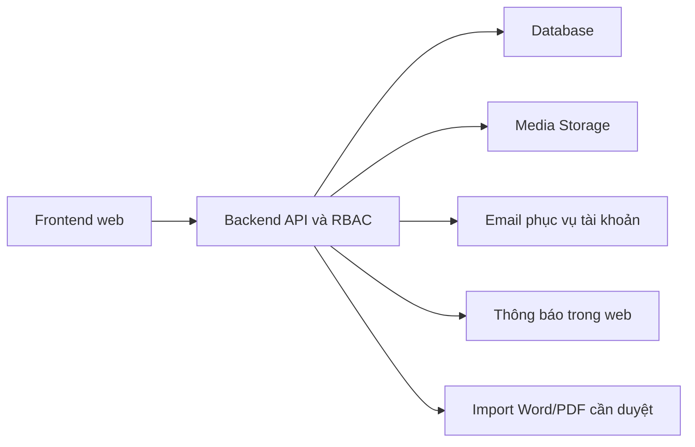

# Technical Baseline (chưa phải thiết kế chính thức)

## Đã biết từ repository WebEdu

- Repo: `https://github.com/luongviettienns/WebEdu` (default `main` ở lần kiểm tra 06/11/2026).
- README: dự kiến tách `backend/` (NestJS REST API), `frontend/` (web client), `prototype/`.
- `PROJECT_PROGRESS.md` đang mô tả giai đoạn thiết lập repository (Phase 0) và kế hoạch NestJS backend với `@nestjs/config`, global ValidationPipe, CORS, `/api/v1`, Swagger `/api/docs`, health endpoint và unit/e2e tests.
- **Chưa xác minh code thực tế có tồn tại các tính năng trên**; tài liệu repo là trạng thái được ghi nhận trong file và có thể lỗi thời.

## Đề xuất thiết kế — CHƯA CHỐT

- Frontend framework và UI library: TBD. Người dùng đang nghiên cứu UI màu xanh lá, minimalism, nét nhận diện Trung Quốc.
- Database/ORM/migration: TBD; không mặc định dùng Prisma/Postgres chỉ vì ở dự án học tập khác từng sử dụng.
- Xác thực/session: chọn chiến lược cookie hoặc token an toàn dựa trên SPA/SSR và nhu cầu triển khai; quyền xác thực/authorization phải test.
- Storage: ảnh câu hỏi, audio nghe, PDF/Word đề cần thiết kế upload, lưu trữ, giới hạn dung lượng, quét file và kiểm soát quyền tải xuống.
- Email: dùng ở recovery; email phụ huynh thay SĐT guardian theo quyết định mới; OTP/email verification và provider chưa xác minh.
- Notification: in-app, không tạo thêm integration Zalo/marketing.
- Hosting/backup/monitoring/CDN: TBD. Nhu cầu ban đầu ~10 người dùng không đồng nghĩa bỏ kiểm soát bảo mật/bảo toàn dữ liệu.

## Kiến trúc logic tham khảo (chưa mặc định code)

## Dependencies cần xử lý theo thời điểm

1. Auth/RBAC → Enrollment/Class.
2. Course + Class → Schedule + Attendance → Progress.
3. Class/Assignment → Submission → Grade/Publish → Exams/Final Score.
4. Notification phụ thuộc event nguồn nhưng chỉ cần in-app.

## Không được làm

Không khẳng định đã cài PostgreSQL/Prisma/React/AntD tại WebEdu nếu chưa đọc code và package files. Không tự đưa AI grading/CRM/e-payment vào Phase 1.
