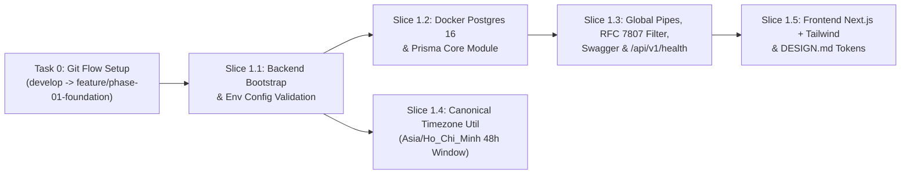

# Phase 1 Implementation Sub-Plan: Khởi Tạo Nền Tảng Kỹ Thuật Fullstack (Foundation & Monorepo Bootstrap)

> **Execution Mode:** Thực thi theo quy trình `akit-implement` (Strict TDD `RED -> GREEN -> REFACTOR`) trên nhánh Git Flow `feature/phase-01-foundation` tách từ `develop`.

- **Goal:** Xây dựng bộ khung nền tảng cho toàn dự án WebEdu gồm `backend/` (NestJS + Prisma ORM + PostgreSQL 16 + Global Validation/RFC 7807 Exception Filter + Swagger + Timezone Helper `Asia/Ho_Chi_Minh`) và `frontend/` (Next.js App Router + Tailwind CSS + Design System Tokens xanh lá Á Đông).
- **Architecture:** Modular Monolith tách bạch `backend/` (REST API tại `/api/v1`) và `frontend/` (Next.js Web Portal), kết nối PostgreSQL qua Prisma ORM với kỷ luật SQL Migration.
- **Trạng thái đối soát (13/11/2026):** **HOÀN THÀNH — MERGED `develop`** (Phase 1 Bootstrap, Prisma schema ban đầu, Next.js/NestJS skeleton, i18n/design tokens & CI đã hoàn tất; các Phase 2–4 kế tiếp cũng đã merge `develop`).
- **Tech Stack (Baseline kế hoạch -> Thực tế đang chạy):** Node.js 20+, TypeScript 5+ (`"strict": true`, cấm `any`), NestJS **12** (kế hoạch ghi 10+), Prisma ORM **6**, PostgreSQL 16, Next.js **16** & React **19** (kế hoạch ghi 14/15), Tailwind CSS **v4**, `date-fns` & `date-fns-tz`, **Vitest** & Supertest (kế hoạch ghi Jest — repo dùng Vitest; E2E chạy qua `backend/vitest.config.e2e.ts`).
- **Ghi chú đối soát `AllExceptionsFilter`:** `AllExceptionsFilter` thực tế trả RFC 7807 theo `ProblemDetailsPayload` (`type`, `title`, `status`, `detail`, `instance`, `timestamp`, `invalidParams?` — **không** dùng `statusCode`/`errors?` và **chưa phát sinh `requestId`** như spec ban đầu; xem [TEST_SCENARIOS_COMPREHENSIVE.md](../TEST_SCENARIOS_COMPREHENSIVE.md) và [PROJECT_PROGRESS.md](../../PROJECT_PROGRESS.md)).
- **Parent Spec:** [`MASTER_PLAN.md`](file:///c:/Users/ASUS/Desktop/WebEdu/MASTER_PLAN.md) & [`architecture-decision-contract.md`](file:///c:/Users/ASUS/Desktop/WebEdu/TD_Han_Ngu_Project_Context_v1.0/docs/03-technical/architecture-decision-contract.md).
- **Prior-Art Decision (`akit-prior-art`):** Sử dụng kiến trúc chuẩn chính thức của `@nestjs/cli`, `@nestjs/config`, `@nestjs/swagger` và `create-next-app` (Adopt 100% official framework conventions).

## Global Constraints (Áp Dụng Bắt Buộc)
1. **Strict Type Safety:** Bật `"strict": true`, `"noImplicitAny": true`, `"strictNullChecks": true` trong cả `backend/tsconfig.json` và `frontend/tsconfig.json`. Cấm sử dụng `any`, `as any`, `@ts-ignore`.
2. **Migration Governance:** Cấm dùng `prisma db push`. Chỉ sử dụng `prisma migrate`.
3. **Timezone Invariant:** Mọi phép tính mốc hạn chót theo ngày học bắt buộc qua `backend/src/common/utils/timezone.util.ts` với múi giờ `Asia/Ho_Chi_Minh` (GMT+7).
4. **Prototype Cleanup Gate:** Giao diện `frontend/` tuyệt đối không chứa thanh "Prototype · Xem với vai trò" (Cleanup #1), nhãn "FUNC-xxx" (Cleanup #6, #7) hay ghi chú nội bộ "chờ chốt" (Cleanup #8).

---

## 1. Sơ Đồ Phụ Thuộc Các Vertical Slices Trong Phase 1

---

## 2. Chi Tiết Các Bite-Sized Vertical Slice Tasks (TDD Ordered)

### Task 0: Thiết Lập Nhánh Git Flow Chuẩn (`akit-git`)
- **Files:** Repository Git branches (`main` $\rightarrow$ `develop` $\rightarrow$ `feature/phase-01-foundation`)
- **Execution Steps:**
  - [x] **Step 0.1:** Commit các tài liệu nền tảng Phase 0 (`MASTER_PLAN.md`, `PROJECT_PROGRESS.md`, `GEMINI.md`, `.gitignore`, `.agents/`, `.akit/`, `TD_Han_Ngu_Project_Context_v1.0/`, `docs/`) vào nhánh hiện tại sau khi kiểm tra không có file nhạy cảm.
  - [x] **Step 0.2:** Tạo nhánh `develop` từ `main` và tách nhánh làm việc `feature/phase-01-foundation` từ `develop`.

---

### Slice 1.1: Khởi Tạo Backend NestJS, Strict TypeScript & Env Validation
- **Files:**
  - Create: `backend/package.json`
  - Create: `backend/tsconfig.json`
  - Create: `backend/.env.example`
  - Create: `backend/src/config/env.validation.ts`
  - Create: `backend/src/config/env.validation.spec.ts`
- **Interfaces:**
  - **Consumes:** Biến môi trường tiến trình (`process.env`).
  - **Produces:** `validateEnv(config: Record<string, unknown>): ValidatedEnvConfig` từ `backend/src/config/env.validation.ts`.
- **Execution Steps (RED $\rightarrow$ GREEN $\rightarrow$ REFACTOR):**
  - [x] **Step 1.1.1 (Scaffold):** Khởi tạo dự án NestJS trong `backend/`, bật `"strict": true` trong `backend/tsconfig.json` và cấu hình `@typescript-eslint/no-explicit-any: "error"`.
  - [x] **Step 1.1.2 (RED):** Viết unit test `backend/src/config/env.validation.spec.ts` kiểm tra: thiếu `DATABASE_URL` hoặc `JWT_SECRET` phải ném lỗi `Error`, cấu hình hợp lệ trả về đúng kiểu `PORT: number`, `NODE_ENV`, `DATABASE_URL`, `TZ: 'Asia/Ho_Chi_Minh'`.
  - [x] **Step 1.1.3 (Verify RED):** Chạy `npm --prefix backend test -- env.validation.spec.ts` và xác nhận test fail.
  - [x] **Step 1.1.4 (GREEN):** Implement `validateEnv` sử dụng `class-validator` & `class-transformer` trong `backend/src/config/env.validation.ts` và tạo `backend/.env.example`.
  - [x] **Step 1.1.5 (Verify GREEN):** Chạy `npm --prefix backend test -- env.validation.spec.ts` và `npm --prefix backend run build` $\rightarrow$ Pass (`Exit 0`).

---

### Slice 1.2: Cấu Hình Docker PostgreSQL 16 & Prisma Core Module
- **Files:**
  - Create: `docker-compose.yml`
  - Create: `backend/prisma/schema.prisma`
  - Create: `backend/src/common/prisma/prisma.service.ts`
  - Create: `backend/src/common/prisma/prisma.module.ts`
  - Create: `backend/src/common/prisma/prisma.service.spec.ts`
- **Interfaces:**
  - **Consumes:** `DATABASE_URL` từ `ConfigService`.
  - **Produces:** `@Global() PrismaModule` và `PrismaService extends PrismaClient` xuất khẩu toàn cục cho mọi module nghiệp vụ.
- **Execution Steps:**
  - [x] **Step 1.2.1 (RED):** Viết unit test `backend/src/common/prisma/prisma.service.spec.ts` xác nhận `PrismaService` gọi `$connect()` khi `onModuleInit()` và `$disconnect()` khi `onModuleDestroy()`.
  - [x] **Step 1.2.2 (Verify RED):** Chạy `npm --prefix backend test -- prisma.service.spec.ts` và xác nhận fail.
  - [x] **Step 1.2.3 (GREEN):** Tạo `docker-compose.yml` (PostgreSQL 16 alpine), `backend/prisma/schema.prisma` (model `SystemSetting` khởi tạo), `PrismaService` và `PrismaModule`, chạy `npx prisma generate`.
  - [x] **Step 1.2.4 (Verify GREEN):** Chạy `npm --prefix backend test -- prisma.service.spec.ts` $\rightarrow$ Pass (`Exit 0`).

---

### Slice 1.3: Global ValidationPipe, RFC 7807 Exception Filter, Swagger & Health Endpoint
- **Files:**
  - Create: `backend/src/common/filters/all-exceptions.filter.ts`
  - Create: `backend/src/common/filters/all-exceptions.filter.spec.ts`
  - Create: `backend/src/modules/health/health.controller.ts`
  - Create: `backend/src/modules/health/health.module.ts`
  - Create: `backend/src/modules/health/health.controller.spec.ts`
  - Modify: `backend/src/app.module.ts`
  - Modify: `backend/src/main.ts`
  - Create: `backend/test/health.e2e-spec.ts`
- **Interfaces:**
  - **Consumes:** `PrismaService` từ Slice 1.2.
  - **Produces:**
    - `GET /api/v1/health` $\rightarrow$ `{ status: 'ok', service: 'webedu-backend', timezone: 'Asia/Ho_Chi_Minh', timestamp: string }`.
    - Swagger OpenAPI docs tại `/api/docs`.
    - Chuẩn lỗi RFC 7807 (`AllExceptionsFilter` thực tế trả `ProblemDetailsPayload`: `{ type, title, status, detail, instance, timestamp, invalidParams? }`, không trả `{ statusCode, error, message, timestamp, path }`).
- **Execution Steps:**
  - [x] **Step 1.3.1 (RED):** Viết unit test `health.controller.spec.ts`, `all-exceptions.filter.spec.ts` và E2E test `backend/test/health.e2e-spec.ts` kiểm tra:
    1. `GET /api/v1/health` trả về `200 OK` với `{ status: 'ok', service: 'webedu-backend', timezone: 'Asia/Ho_Chi_Minh' }`.
    2. Request tới route không tồn tại trả về `404` đúng định dạng `{ statusCode: 404, error, message, timestamp, path }`.
  - [x] **Step 1.3.2 (Verify RED):** Chạy `npm --prefix backend test` và `npm --prefix backend run test:e2e` $\rightarrow$ xác nhận fail.
  - [x] **Step 1.3.3 (GREEN):** Implement `AllExceptionsFilter`, `HealthModule`, cấu hình prefix `/api/v1`, Global `ValidationPipe({ whitelist: true, forbidNonWhitelisted: true, transform: true })`, CORS và Swagger `/api/docs`.
  - [x] **Step 1.3.4 (Verify GREEN):** Chạy `npm --prefix backend test` và `npm --prefix backend run test:e2e` $\rightarrow$ Pass 100% (`Exit 0`).

---

### Slice 1.4: Canonical Timezone Helper (`Asia/Ho_Chi_Minh` End-of-Day Rule)
- **Files:**
  - Create: `backend/src/common/utils/timezone.util.ts`
  - Create: `backend/src/common/utils/timezone.util.spec.ts`
- **Interfaces:**
  - **Consumes:** `date-fns`, `date-fns-tz`.
  - **Produces:**
    - `VN_TIMEZONE = 'Asia/Ho_Chi_Minh'`
    - `calculateTeacherAttendanceDeadline(lessonDate: Date): Date` (trả về mốc UTC tương ứng `23:59:59.999` của ngày thứ 2 sau ngày học theo giờ Việt Nam).
    - `isWithinTeacherAttendanceWindow(lessonDate: Date, now?: Date): boolean`
- **Execution Steps:**
  - [x] **Step 1.4.1 (RED):** Viết unit test `backend/src/common/utils/timezone.util.spec.ts` kiểm chứng:
    1. Buổi học diễn ra lúc `2026-11-10T08:00:00+07:00` hoặc `2026-11-10T20:30:00+07:00` đều có hạn sửa điểm danh là `2026-11-12T23:59:59.999+07:00`.
    2. Tại thời điểm `2026-11-12T23:59:59.000+07:00` $\rightarrow$ `isWithinTeacherAttendanceWindow` trả về `true`.
    3. Tại thời điểm `2026-11-13T00:00:00.000+07:00` $\rightarrow$ `isWithinTeacherAttendanceWindow` trả về `false`.
  - [x] **Step 1.4.2 (Verify RED):** Chạy `npm --prefix backend test -- timezone.util.spec.ts` $\rightarrow$ xác nhận fail.
  - [x] **Step 1.4.3 (GREEN):** Implement `timezone.util.ts` với `date-fns` và `date-fns-tz`.
  - [x] **Step 1.4.4 (Verify GREEN):** Chạy `npm --prefix backend test -- timezone.util.spec.ts` $\rightarrow$ Pass 100% (`Exit 0`).

---

### Slice 1.5: Khởi Tạo Frontend Next.js (App Router) + Tailwind CSS & `DESIGN.md` Tokens
- **Files:**
  - Create: `DESIGN.md`
  - Create: `frontend/package.json`
  - Create: `frontend/tsconfig.json`
  - Create: `frontend/src/app/layout.tsx`
  - Create: `frontend/src/app/page.tsx`
  - Create: `frontend/src/lib/api-client.ts`
- **Interfaces:**
  - **Consumes:** `NEXT_PUBLIC_API_URL` (`http://localhost:3001/api/v1`).
  - **Produces:** Khung ứng dụng Next.js App Router + Tailwind CSS chuẩn màu xanh lá trúc tối giản (`DESIGN.md`), helper `apiClient` gọi Backend, loại bỏ hoàn toàn thanh demo prototype và nhãn `FUNC-xxx`.
- **Execution Steps:**
  - [x] **Step 1.5.1:** Tạo tài liệu `DESIGN.md` định nghĩa hệ thống màu sắc xanh lá tối giản (Oriental Bamboo Green), hệ thống font hỗ trợ tiếng Việt + chữ Hán (Noto Sans SC / Inter) và quy tắc chống AI-slop.
  - [x] **Step 1.5.2:** Khởi tạo `frontend/` với Next.js App Router + TypeScript Strict + Tailwind CSS, cấu hình `api-client.ts` và trang Portal khởi đầu của Trung tâm TD Hán Ngữ.
  - [x] **Step 1.5.3 (Verify GREEN):** Chạy `npm --prefix frontend run lint` và `npm --prefix frontend run build` $\rightarrow$ Pass 100% (`Exit 0`).

---

## 3. Bảng Kiểm Tra Xung Đột Trước Thực Thi (Pre-Flight Conflict Scan)

| Task Pair | Shared File / Interface (`Produces` $\rightarrow$ `Consumes`) | Kiểm tra tính nhất quán (Consistency Check) | Ruling |
| :--- | :--- | :--- | :---: |
| `Slice 1.1 -> Slice 1.2` | `backend/src/config/env.validation.ts` (`ValidatedEnvConfig`) | `PrismaService` đọc `DATABASE_URL` đã được validate | **Clean** |
| `Slice 1.2 -> Slice 1.3` | `backend/src/common/prisma/prisma.module.ts` (`PrismaModule`) | `AppModule` import `PrismaModule` và `HealthModule` không trùng lặp | **Clean** |
| `Slice 1.3 -> Slice 1.5` | `GET /api/v1/health` (`HealthResponseDto`) | `frontend/src/lib/api-client.ts` khớp tiền tố `/api/v1` và cấu trúc lỗi RFC 7807 | **Clean** |
