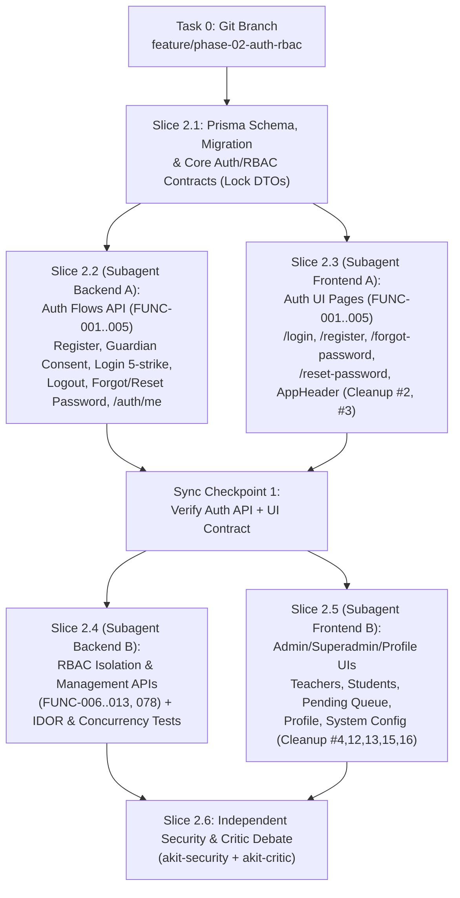

# Phase 2 Implementation Sub-Plan: Module 01 — Tài Khoản, Xác Thực & Phân Quyền RBAC (`FUNC-001..013`, `FUNC-078`)

> **Execution Mode:** Thực thi theo quy trình **Superpowers Subagent-Driven Development (SDD)** & **Parallel Subagents Dispatch** (`dispatching-parallel-agents` + `akit-implement` Strict TDD `RED -> GREEN -> REFACTOR`) trên nhánh Git Flow `feature/phase-02-auth-rbac` tách từ `develop`.
> **Debate & Security Hardened:** Đã tích hợp 100% các chốt chặn từ phiên phản biện song song của `akit-critic` và `akit-security` (`SEC-01..10`).

- **Goal:** Xây dựng hoàn chỉnh hệ thống Định danh, Xác thực (Đăng ký học viên $\ge 12$ tuổi, Xác nhận Email phụ huynh cho học viên $12\text{–}15$ tuổi, Đăng nhập bằng Email khóa 15 phút khi sai 5 lần, Đăng xuất & Idle Timeout 60 phút, Khôi phục mật khẩu qua email), Phân quyền RBAC đa vai trò (`FUNC-009` kết hợp cô lập dữ liệu học tập khỏi Superadmin theo `FUNC-013`), Quản lý Giáo viên/Học viên/Hồ sơ cá nhân và Vận hành hệ thống Superadmin.
- **Architecture:** Modular Monolith — Backend NestJS 12 (`AuthModule`, `UsersModule`, `TeachersModule`, `StudentsModule`, `SystemSettingsModule`, `AuditLogsModule`) + Prisma 6.4.1 (`@db.Timestamptz(3)` chuẩn UTC) + Frontend Next.js 16 (App Router) + Tailwind CSS v4.
- **Tech Stack:** NestJS 12, `@nestjs/jwt`, `@nestjs/passport`, `cookie-parser`, `bcryptjs` (hash mật khẩu với dummy hash chống timing attack), `node:crypto` (`randomBytes(32)` + `SHA-256` cho reset token), `class-validator`, Prisma 6.4.1 (PostgreSQL 16 `TIMESTAMPTZ(3)`), Next.js 16, Vitest & Supertest.
- **Parent Spec:** [`MASTER_PLAN.md`](file:///c:/Users/ASUS/Desktop/WebEdu/MASTER_PLAN.md), [`01-tai-khoan-phan-quyen.md`](file:///c:/Users/ASUS/Desktop/WebEdu/TD_Han_Ngu_Project_Context_v1.0/docs/02-requirements/modules/01-tai-khoan-phan-quyen.md), [`roles-permissions.md`](file:///c:/Users/ASUS/Desktop/WebEdu/TD_Han_Ngu_Project_Context_v1.0/docs/01-business/roles-permissions.md), [`architecture-decision-contract.md`](file:///c:/Users/ASUS/Desktop/WebEdu/TD_Han_Ngu_Project_Context_v1.0/docs/03-technical/architecture-decision-contract.md).

---

## Global Constraints & Security Invariants (Đã Khóa Sau Phản Biện `akit-critic` & `akit-security`)

1. **Strict Type Safety & Linter:** `tsc --noEmit` và `oxlint --type-aware` (`typescript/no-explicit-any: "error"`) phải đạt **0 warnings, 0 errors**. Cấm tuyệt đối `any`, `as any`, `@ts-ignore`.
2. **PostgreSQL `TIMESTAMPTZ(3)` & Foreign Key `RESTRICT` Governance:**
   - Mọi cột thời gian (`createdAt`, `updatedAt`, `lockedUntil`, `consentedAt`, `expiresAt`, `lastLoginAt`, `lastActivityAt`) bắt buộc khai báo `@db.Timestamptz(3)`.
   - Quan hệ `StudentProfile -> User`, `GuardianConsent -> StudentProfile`, `TeacherProfile -> User` bắt buộc dùng **`onDelete: Restrict`** (không dùng `Cascade`) để cưỡng chế quy tắc *"Không xóa vĩnh viễn tài khoản GV/HV đã có dữ liệu"* (`FUNC-006, 007`) và bảo vệ bằng chứng pháp lý `GuardianConsent` (`BR-07`).
   - Cấm tuyệt đối `prisma db push`.
3. **Chuẩn Hóa Tính Tuổi Học Viên Ở Biên Múi Giờ (`Critic #3`):**
   - Hàm `calculateAgeInVnTimezone(dob: Date, referenceInstant: Date = new Date()): number`: trích xuất `(dobY, dobM, dobD)` từ UTC date parts của cột `@db.Date` (tránh lỗi lùi 1 ngày khi chạy trong khung 00:00–06:59 sáng giờ VN), và so sánh với `(refY, refM, refD)` của `referenceInstant` tại múi giờ `Asia/Ho_Chi_Minh` (xử lý chuẩn cả năm nhuận `29/02`).
   - Khi kiểm tra sửa Ngày sinh ở `FUNC-007` cho HV chưa có `GuardianConsent`, bắt buộc truyền `referenceInstant = user.createdAt` (tính tuổi tại đúng thời điểm đăng ký!).
4. **Giải Quyết Mâu Thuẫn Phân Quyền `FUNC-009` vs `FUNC-013` (`SEC-01` & `Critic #1`):**
   - `getHighestRole(roles: Role[]): Role`: xác định `effectiveRole` và `redirectTo` theo thứ tự `SUPERADMIN > ADMIN > TEACHER > STUDENT`.
   - `expandAuthorizedRoles(userRoles: Role[]): Set<Role>`:
     - Giữ nguyên mọi role có trong `userRoles`.
     - Nếu `userRoles` chứa `Role.ADMIN`, tự động mở rộng thêm quyền nghiệp vụ của `Role.TEACHER` (để user kiêm nhiệm hoặc Admin thực thi quyền quản lý đào tạo theo `FUNC-009, 012`).
     - **`Role.SUPERADMIN` TUYỆT ĐỐI KHÔNG tự động kế thừa `Role.ADMIN`, `Role.TEACHER` hay `Role.STUDENT`**!
     - Các API mà cả Admin và Superadmin cùng được phép gọi (`FUNC-006` Quản lý GV, `FUNC-007` Quản lý HV) khai báo tường minh `@Roles(Role.ADMIN, Role.SUPERADMIN)`. Nhờ đó, các API dữ liệu học tập (bài làm, điểm) chỉ gắn `@Roles(Role.ADMIN, Role.TEACHER)` hoặc `@Roles(Role.STUDENT)` sẽ tự động chặn `SUPERADMIN` (`403 Forbidden`), tuân thủ tuyệt đối `FUNC-013`.
5. **Stateful Session Verification, Idle Timeout 60p & CSRF (`SEC-02`, `SEC-03`):**
   - `JwtAuthGuard` truy vấn DB theo PK (`id`), từ chối ngay (`401`/`403`) nếu: `!user`, `user.status === INACTIVE`, `user.tokenVersion !== payload.tokenVersion`, hoặc `now - user.lastActivityAt > 60 phút` (`FUNC-004`).
   - Khi Admin/Superadmin khóa tài khoản (`status -> INACTIVE`), thay đổi `roles`, hoặc khi người dùng đổi mật khẩu/đăng xuất, bắt buộc tăng `tokenVersion: { increment: 1 }`.
   - Với các request thay đổi dữ liệu (`POST`, `PUT`, `PATCH`, `DELETE`) dùng Cookie Auth, kiểm tra header `Origin` khớp whitelist `allowedOrigins` để chống CSRF.
6. **7 Quy Tắc Dọn Dẹp Prototype Bắt Buộc Ở Phase 2 (`prototype-review.md`):**
   - **Cleanup #2:** Bỏ khối "Tài khoản demo" ở màn Đăng nhập.
   - **Cleanup #3:** Bỏ dòng gợi ý "Thử lỗi" ở màn Đăng nhập & Đăng ký.
   - **Cleanup #4:** Bỏ checkbox "Xem như tài khoản Chờ xếp lớp" ở màn Học viên.
   - **Cleanup #12:** Cột "Đồng ý cha mẹ" trong danh sách Chờ xếp lớp chỉ hiển thị `Đã xác nhận` (HV $< 16$ tuổi) hoặc `Không áp dụng` (HV $\ge 16$ tuổi); **bỏ giá trị `Thiếu`**.
   - **Cleanup #13:** Bỏ trường "Đăng ký lúc" trong chi tiết Hồ sơ học viên của Admin.
   - **Cleanup #15:** Bỏ trường "Múi giờ" trong màn Cấu hình hệ thống của Superadmin.
   - **Cleanup #16:** Giữ tag `"Admin"` cạnh Họ tên Giáo viên kiêm nhiệm vai trò Admin trong Danh sách giáo viên.

---

## 1. Giải Quyết Các Open Issues Đầu Phase 2 (`AUTH-01..04`, `DEC-023`)

| Mã Issue | Vấn đề trong `open-issues.md` | Phương án Thiết kế Kỹ thuật Đã Chốt (`DEC-023`) |
|---|---|---|
| **`AUTH-01`** | Email phụ huynh lưu riêng với email đăng nhập HV hay dùng chung? Hai anh/chị em dưới 16 tuổi dùng chung email phụ huynh đăng ký thế nào? | - Mỗi tài khoản `User` có `email` đăng nhập là **bắt buộc và `UNIQUE`** (luôn chuẩn hóa `.trim().toLowerCase()`).<br>- Bảng `StudentProfile` lưu trường riêng `guardianEmail` (`VARCHAR(255)`, **không đặt `UNIQUE`**) cho HV $12\text{–}15$ tuổi. Nhờ đó 2 anh/chị em dưới 16 tuổi dùng chung 1 `guardianEmail` của cha mẹ hoàn toàn hợp lệ. |
| **`AUTH-02`** | SĐT học viên có bắt buộc/duy nhất không sau khi đổi SĐT phụ huynh sang Email phụ huynh (`DEC-001`)? Đăng nhập bằng gì? | - **Đã chốt (`DEC-023`):** Cả `email` và `phone` (10 chữ số, bắt đầu bằng `0`) trên bảng `User` đều **bắt buộc và `UNIQUE`** trên toàn hệ thống.<br>- Nếu đăng ký hoặc sửa hồ sơ trùng `email` hoặc `phone` của người khác $\rightarrow$ trả về `409 Conflict` `"Email/Số điện thoại đã được sử dụng"`.<br>- **Đăng nhập (`FUNC-003`):** **Chỉ dùng `email` làm tên đăng nhập (`username`)**. Không đăng nhập bằng SĐT. |
| **`AUTH-03`** | Nội dung cam kết đồng ý của phụ huynh và dữ liệu lưu vết (`FUNC-002`)? | - Khi ngày sinh làm tuổi $12 \le \text{tuổi} < 16$: bắt buộc nhập `guardianEmail` hợp lệ + tick checkbox xác nhận.<br>- Backend tự lấy hằng số `CONSENT_TEXT_V1_0` trên Server (không nhận văn bản từ Client theo `SEC-10`) để lưu bản ghi bất biến vào bảng `GuardianConsent`: `studentProfileId`, `guardianEmail`, `consentVersion` (`"v1.0"`), `consentTextSnapshot`, `consentedAt` (`TIMESTAMPTZ(3)`), `ipAddress`, `userAgent`. |
| **`AUTH-04`** | Phạm vi `FUNC-006, 007, 008, 078` (Dự kiến P1)? | - Triển khai trọn vẹn cả 4 chức năng ngay trong Phase 2 để khép kín vòng đời Tài khoản từ lúc HV đăng ký (`PENDING_CLASS`) $\rightarrow$ Admin quản lý hồ sơ/xếp lớp (`ACTIVE`) $\rightarrow$ Tự quản lý hồ sơ & đổi mật khẩu. |

---

## 2. Sơ Đồ Kiến Trúc & Chiến Lược Chạy Song Song (Parallel Subagents)



---

## 3. Thiết Kế Cơ Sở Dữ Liệu (Prisma Schema — `TIMESTAMPTZ(3)` & `onDelete: Restrict`)

Bổ sung vào `backend/prisma/schema.prisma`:

```prisma
enum Role {
  STUDENT
  TEACHER
  ADMIN
  SUPERADMIN
}

enum UserStatus {
  PENDING_CLASS // Chờ xếp lớp (dành cho HV mới đăng ký FUNC-001)
  ACTIVE        // Đang hoạt động (mặc định khi tạo GV/Admin FUNC-006, 013)
  INACTIVE      // Vô hiệu hóa (khóa bởi Admin/Superadmin)
}

model User {
  id                  String      @id @default(uuid())
  email               String      @unique @db.VarChar(255)
  phone               String      @unique @db.VarChar(15)
  fullName            String      @map("full_name") @db.VarChar(100)
  passwordHash        String      @map("password_hash") @db.VarChar(255)
  roles               Role[]      @default([STUDENT])
  status              UserStatus  @default(PENDING_CLASS)
  failedLoginAttempts Int         @default(0) @map("failed_login_attempts")
  lockedUntil         DateTime?   @map("locked_until") @db.Timestamptz(3)
  tokenVersion        Int         @default(0) @map("token_version")
  lastLoginAt         DateTime?   @map("last_login_at") @db.Timestamptz(3)
  lastActivityAt      DateTime?   @map("last_activity_at") @db.Timestamptz(3)
  createdAt           DateTime    @default(now()) @map("created_at") @db.Timestamptz(3)
  updatedAt           DateTime    @updatedAt @map("updated_at") @db.Timestamptz(3)

  studentProfile      StudentProfile?
  teacherProfile      TeacherProfile?
  passwordResetTokens PasswordResetToken[]
  auditLogsAsActor    SystemAuditLog[]     @relation("AuditActor")

  @@index([status])
  @@map("users")
}

model StudentProfile {
  id            String           @id @default(uuid())
  userId        String           @unique @map("user_id")
  dateOfBirth   DateTime         @map("date_of_birth") @db.Date
  guardianEmail String?          @map("guardian_email") @db.VarChar(255)
  internalNotes String?          @map("internal_notes") @db.Text
  enrolledAt    DateTime?        @map("enrolled_at") @db.Timestamptz(3)
  createdAt     DateTime         @default(now()) @map("created_at") @db.Timestamptz(3)
  updatedAt     DateTime         @updatedAt @map("updated_at") @db.Timestamptz(3)

  user          User             @relation(fields: [userId], references: [id], onDelete: Restrict)
  consent       GuardianConsent?

  @@index([guardianEmail])
  @@map("student_profiles")
}

model GuardianConsent {
  id                  String         @id @default(uuid())
  studentProfileId    String         @unique @map("student_profile_id")
  guardianEmail       String         @map("guardian_email") @db.VarChar(255)
  consented           Boolean        @default(true)
  consentVersion      String         @map("consent_version") @db.VarChar(20)
  consentTextSnapshot String         @map("consent_text_snapshot") @db.Text
  ipAddress           String?        @map("ip_address") @db.VarChar(64)
  userAgent           String?        @map("user_agent") @db.VarChar(500)
  consentedAt         DateTime       @default(now()) @map("consented_at") @db.Timestamptz(3)

  studentProfile      StudentProfile @relation(fields: [studentProfileId], references: [id], onDelete: Restrict)

  @@map("guardian_consents")
}

model TeacherProfile {
  id                 String   @id @default(uuid())
  userId             String   @unique @map("user_id")
  notes              String?  @db.Text
  activeClassesCount Int      @default(0) @map("active_classes_count")
  createdAt          DateTime @default(now()) @map("created_at") @db.Timestamptz(3)
  updatedAt          DateTime @updatedAt @map("updated_at") @db.Timestamptz(3)

  user               User     @relation(fields: [userId], references: [id], onDelete: Restrict)

  @@map("teacher_profiles")
}

model PasswordResetToken {
  id        String    @id @default(uuid())
  userId    String    @map("user_id")
  tokenHash String    @unique @map("token_hash") @db.VarChar(128)
  expiresAt DateTime  @map("expires_at") @db.Timestamptz(3)
  usedAt    DateTime? @map("used_at") @db.Timestamptz(3)
  createdAt DateTime  @default(now()) @map("created_at") @db.Timestamptz(3)

  user      User      @relation(fields: [userId], references: [id], onDelete: Cascade)

  @@index([userId, createdAt])
  @@map("password_reset_tokens")
}

model SystemAuditLog {
  id         String   @id @default(uuid())
  actorId    String?  @map("actor_id")
  actingRole Role?    @map("acting_role")
  action     String   @db.VarChar(100)
  targetType String   @db.VarChar(100) @map("target_type")
  targetId   String?  @db.VarChar(100) @map("target_id")
  metadata   Json?
  createdAt  DateTime @default(now()) @map("created_at") @db.Timestamptz(3)

  actor      User?    @relation("AuditActor", fields: [actorId], references: [id], onDelete: SetNull)

  @@index([createdAt(sort: Desc)])
  @@index([actorId])
  @@map("system_audit_logs")
}
```

---

## 3.5. Bảng Khóa Cứng Hợp Đồng REST API (Locked Contracts Giữa Backend & Frontend Subagents)

Để đảm bảo **Zero Contract Drift** khi chạy song song Subagent Backend và Subagent Frontend (`Critic #4`), mọi API tuân thủ chính xác bảng hợp đồng dưới đây:

### A. Đợt 1 — Authentication Endpoints (`/api/v1/auth/*`)
1. **`POST /api/v1/auth/register` (`FUNC-001, 002`):**
   - Request Body: `{ fullName: string; dateOfBirth: string /* YYYY-MM-DD */; phone: string; email: string; password: string; confirmPassword?: string; guardianEmail?: string; guardianConsent?: boolean }`
   - Response `201 Created`: `{ message: "Đăng ký thành công. Vui lòng chờ trung tâm xếp lớp", user: AuthUserDto }`
2. **`POST /api/v1/auth/login` (`FUNC-003`):**
   - Request Body: `{ email: string; password: string; rememberMe?: boolean }`
   - Response `200 OK`: `{ accessToken: string; expiresIn: number; redirectTo: string; user: AuthUserDto }`
   - Quy tắc `redirectTo` theo `effectiveRole`:
     - `SUPERADMIN` $\rightarrow$ `'/superadmin/settings'`
     - `ADMIN` $\rightarrow$ `'/admin/students'`
     - `TEACHER` $\rightarrow$ `'/teacher/classes'`
     - `STUDENT` $\rightarrow$ `'/student/overview'`
3. **`GET /api/v1/auth/me`:**
   - Response `200 OK`: `AuthUserDto` (`{ id, email, fullName, phone, roles, effectiveRole, status, dateOfBirth?: string }`)
4. **`POST /api/v1/auth/logout` (`FUNC-004`):**
   - Response `200 OK`: `{ message: "Đăng xuất thành công" }`
5. **`POST /api/v1/auth/forgot-password` (`FUNC-005` Bước 1):**
   - Request Body: `{ email: string }`
   - Response `200 OK`: `{ message: "Nếu tài khoản tồn tại, hướng dẫn đã được gửi", cooldownSeconds: 60 }`
6. **`POST /api/v1/auth/reset-password` (`FUNC-005` Bước 2):**
   - Request Body: `{ token: string; newPassword: string; confirmPassword?: string }`
   - Response `200 OK`: `{ message: "Đặt lại mật khẩu thành công" }`

### B. Đợt 2 — Profile, Teachers, Students & System Settings Endpoints
1. **Profile (`/api/v1/profile/*` — `FUNC-078`):**
   - `GET /api/v1/profile/me` $\rightarrow$ Thông tin cá nhân đầy đủ.
   - `PATCH /api/v1/profile/me` (`{ fullName?: string; phone?: string; email?: string; currentPassword?: string }`) $\rightarrow$ Nếu đổi `email`, yêu cầu `currentPassword` và tăng `tokenVersion`.
   - `POST /api/v1/profile/change-password` (`{ currentPassword: string; newPassword: string; confirmPassword?: string }`).
2. **Teachers (`/api/v1/teachers/*` — `FUNC-006`, `@Roles(Role.ADMIN, Role.SUPERADMIN)`):**
   - `GET /api/v1/teachers?search=&status=&page=1&limit=20` $\rightarrow$ `{ items: TeacherItemDto[], total, page, limit }` (có cờ `isAdmin: boolean`).
   - `POST /api/v1/teachers` (`{ fullName, phone, email, initialPassword, notes? }`) $\rightarrow$ Tạo với `status = ACTIVE`, `roles = [TEACHER]`.
   - `PATCH /api/v1/teachers/:id` (`{ fullName?, phone?, email?, notes?, status? }`) $\rightarrow$ Chặn chuyển sang `INACTIVE` nếu `activeClassesCount > 0`.
3. **Students (`/api/v1/students/*` — `FUNC-007, 008`, `@Roles(Role.ADMIN, Role.SUPERADMIN)`):**
   - `GET /api/v1/students?search=&status=&page=1&limit=20`
   - `GET /api/v1/students/pending-enrollment` $\rightarrow$ `{ items: PendingStudentDto[], totalPending: number }` (cột `guardianConsentStatus: 'CONFIRMED' | 'NOT_APPLICABLE'`).
   - `GET /api/v1/students/:id` (Học viên chỉ gọi được `:id === currentUser.id` theo `FUNC-010`; Admin/Superadmin xem được tất cả).
   - `PATCH /api/v1/students/:id` (`{ fullName?, phone?, email?, dateOfBirth?, status?, internalNotes? }`).
   - `POST /api/v1/students/:id/assign-initial-class` (`{ classNameOrId: string; enrolledAt?: string }`).
4. **Superadmin (`/api/v1/system-settings/*` — `FUNC-013`, `@Roles(Role.SUPERADMIN)`):**
   - `GET /api/v1/system-settings/users` & `POST /api/v1/system-settings/users` & `PATCH /api/v1/system-settings/users/:id/roles` (`{ roles: Role[]; status?: UserStatus }`).
   - `GET /api/v1/system-settings/config` & `PUT /api/v1/system-settings/config` (`{ centerName: string; centerLogoBase64?: string }`).
   - `GET /api/v1/system-settings/audit-logs?page=1&limit=20`.

---

## 4. Chi Tiết Các Bite-Sized Vertical Slices (Ordered TDD Tasks)

### Slice 2.1: Khóa Schema Prisma, Migration `TIMESTAMPTZ` & Core RBAC Contracts
- **Chạy bởi:** Coordinator Agent.
- **Files:**
  - Modify: `backend/package.json` (cài đặt `@nestjs/jwt`, `@nestjs/passport`, `passport`, `passport-jwt`, `cookie-parser`, `bcryptjs` và `@types/*`)
  - Modify: `backend/src/main.ts` (mount `cookieParser()`)
  - Modify: `backend/prisma/schema.prisma`
  - Create: `backend/prisma/migrations/20261106171000_init_auth_users_rbac/migration.sql`
  - Modify: `backend/src/common/utils/timezone.util.ts` & `timezone.util.spec.ts` (`calculateAgeInVnTimezone(dob, referenceInstant)`)
  - Create: `backend/src/common/auth/role-hierarchy.util.ts` & `role-hierarchy.util.spec.ts` (`getHighestRole`, `expandAuthorizedRoles`, `hasRequiredRole`)
  - Create: `backend/src/common/decorators/roles.decorator.ts` & `current-user.decorator.ts`
  - Create: `backend/src/common/guards/jwt-auth.guard.ts` & `roles.guard.ts` & `roles.guard.spec.ts`
  - Modify: `frontend/src/lib/api-client.ts` (bổ sung `credentials: 'include'` và tự động đính kèm Bearer token khi có)
- **TDD Verification:**
  - Kiểm chứng `calculateAgeInVnTimezone` đúng tại `00:05 GMT+7` (`17:05Z` hôm trước), năm nhuận `29/02`, và kiểm chứng `RolesGuard` chặn `SUPERADMIN` truy cập endpoint chỉ dành cho `[ADMIN, TEACHER]` hoặc `[STUDENT]`.

---

### Slice 2.2 (Subagent Backend A — Song song Đợt 1): Core Authentication API (`FUNC-001..005`)
- **Files:**
  - Create: `backend/src/modules/auth/dto/*.dto.ts`
  - Create: `backend/src/modules/auth/auth.service.ts` & `auth.service.spec.ts`
  - Create: `backend/src/modules/auth/auth.controller.ts` & `auth.module.ts`
  - Create: `backend/test/auth.e2e-spec.ts`
- **Hardened Security & Business Rules (RED $\rightarrow$ GREEN):**
  1. **`FUNC-001, 002` (Đăng ký & Đồng ý cha mẹ):**
     - Chuẩn hóa `email = email.trim().toLowerCase()`.
     - Tuổi $< 12$: `400 Bad Request` `"Học viên phải từ 12 tuổi trở lên"`.
     - Tuổi $12\text{–}15$: bắt buộc `guardianEmail` hợp lệ + `guardianConsent === true` (thiếu báo `"Vui lòng xác nhận đã có sự đồng ý của cha mẹ"`). Ghi `GuardianConsent` với hằng số `CONSENT_TEXT_V1_0` trên server. Hai anh/chị em dùng chung `guardianEmail` đăng ký thành công 100%.
     - Trùng `email` hoặc `phone`: `409 Conflict` `"Email/Số điện thoại đã được sử dụng"`.
  2. **`FUNC-003` (Đăng nhập bằng Email, Anti-Timing & Atomic 5-Strike Lockout):**
     - Chỉ nhận `email` làm tên đăng nhập. Nếu không tìm thấy user, chạy `await bcrypt.compare(password, DUMMY_PASSWORD_HASH)` trước khi trả `401` `"Tên đăng nhập hoặc mật khẩu không đúng"`.
     - Nếu `lockedUntil > now`: trả `423 Locked` (hoặc `403`) `"Tài khoản tạm khóa 15 phút do nhập sai mật khẩu quá 5 lần"` (kể cả nhập đúng mật khẩu).
     - Nếu sai mật khẩu: cập nhật nguyên tử bằng SQL (`CASE WHEN locked_until <= NOW() THEN 1 ELSE failed_login_attempts + 1 END`) và khóa 15 phút khi chạm `5`. Có bài test `Promise.all` 6 request sai đồng thời!
  3. **`FUNC-004` (Đăng xuất & Idle Timeout 60p):**
     - `POST /api/v1/auth/logout`: tăng `tokenVersion` và xóa cookie.
     - Cập nhật `lastActivityAt`; quá 60 phút không hoạt động $\rightarrow$ `401 Unauthorized`.
  4. **`FUNC-005` (Quên/Đặt lại mật khẩu chống User Enumeration ở Cooldown 60s):**
     - Cooldown 60s lưu theo `SHA-256(normalizedEmail)` cho **mọi email** (kể cả email không tồn tại trong DB) để chống dò tài khoản qua mã `429`.
     - Token sinh bằng `crypto.randomBytes(32).toString('hex')`, lưu `SHA-256` vào `PasswordResetToken.tokenHash`, hết hạn sau **15 phút**, tiêu thụ 1 lần nguyên tử bằng `updateMany`.

---

### Slice 2.3 (Subagent Frontend A — Song song Đợt 1): Giao Diện Xác Thực (`/login`, `/register`, `/forgot-password`, `/reset-password`)
- **Files:**
  - Create: `frontend/src/lib/auth-api.ts`
  - Create: `frontend/src/components/auth/PasswordInput.tsx`
  - Create: `frontend/src/app/(auth)/login/page.tsx` (`FUNC-003` — đăng nhập bằng Email)
  - Create: `frontend/src/app/(auth)/register/page.tsx` (`FUNC-001, 002` — ẩn/hiện động khối Email cha mẹ & checkbox đồng ý khi $12 \le \text{tuổi} < 16$)
  - Create: `frontend/src/app/(auth)/forgot-password/page.tsx` & `reset-password/page.tsx` (`FUNC-005` + đếm ngược 60s)
  - Create: `frontend/src/components/layout/AppHeader.tsx` (`FUNC-004` Menu tài khoản + Đăng xuất + Cảnh báo 5 phút trước khi hết hạn 60p không hoạt động)
- **Prototype Cleanup:** Tuyệt đối không có khối "Tài khoản demo" (**Cleanup #2**) và dòng gợi ý "Thử lỗi" (**Cleanup #3**).

---

### Slice 2.4 (Subagent Backend B — Song song Đợt 2): Quản Lý Người Dùng, Hồ Sơ, RBAC Isolation & Superadmin (`FUNC-006..013, 078`)
- **Files:**
  - Create: `backend/src/modules/users/profile.controller.ts` & `profile.service.ts` (`FUNC-078`)
  - Create: `backend/src/modules/teachers/teachers.controller.ts`, `teachers.service.ts` & `teachers.service.spec.ts` (`FUNC-006`)
  - Create: `backend/src/modules/students/students.controller.ts`, `students.service.ts` & `students.service.spec.ts` (`FUNC-007, 008, 010`)
  - Create: `backend/src/modules/system-settings/system-settings.controller.ts`, `system-settings.service.ts` & `system-settings.service.spec.ts` (`FUNC-013`)
  - Create: `backend/test/rbac-isolation.e2e-spec.ts`
- **Hardened Security & Business Rules (RED $\rightarrow$ GREEN):**
  1. **`FUNC-006` (Quản lý Giáo viên):** Tạo mới luôn set `status = ACTIVE`, `roles = [TEACHER]`. Trả về cờ `isAdmin` (**Cleanup #16**). Chặn vô hiệu hóa khi `activeClassesCount > 0`. Chặn `ADMIN` tác động lên tài khoản `SUPERADMIN` (`SEC-08`).
  2. **`FUNC-007, 008` (Quản lý Học viên & Chờ xếp lớp):**
     - Khóa sửa `dateOfBirth` nếu đã có `GuardianConsent`. Nếu chưa có `GuardianConsent`, kiểm tra tuổi của `dateOfBirth` mới so với **`user.createdAt`** (nếu $< 16$ tại thời điểm đăng ký $\rightarrow$ chặn lưu với lỗi `"Không thể sửa ngày sinh: học viên dưới 16 tuổi cần xác nhận đồng ý của cha mẹ khi đăng ký"`).
     - Danh sách chờ xếp lớp trả về `guardianConsentStatus: 'CONFIRMED' | 'NOT_APPLICABLE'` (**Cleanup #12**).
  3. **`FUNC-009..012` (RBAC & IDOR Cross-Account Tests):**
     - Học viên A truy cập/sửa dữ liệu Học viên B nhận `403 Forbidden` `"Bạn không có quyền truy cập"`.
     - Tài khoản chỉ có `SUPERADMIN` gọi endpoint dữ liệu học tập nhận `403 Forbidden` (`FUNC-013`).
  4. **`FUNC-013` (Superadmin Vận hành hệ thống):**
     - Khóa dòng `SELECT id FROM "users" WHERE 'SUPERADMIN' = ANY("roles") AND "status" = 'ACTIVE' FOR UPDATE` trong `prisma.$transaction` trước khi hạ quyền/vô hiệu hóa để chống Write-Skew làm mất Superadmin cuối cùng (`SEC-07`). Chặn tự khóa mình hoặc tự gỡ role `SUPERADMIN`.
     - Upload/lưu Logo trung tâm: kiểm tra **Magic Bytes** thực tế của PNG (`89 50 4E 47`) và JPEG (`FF D8 FF`), giới hạn $\le 2\text{MB}$, chặn tuyệt đối `.svg` chứa XSS (`SEC-09`).
     - Hàm `sanitizeAuditMetadata()` tự động redact mọi trường mật khẩu/token trước khi lưu `SystemAuditLog` (`SEC-10`).

---

### Slice 2.5 (Subagent Frontend B — Song song Đợt 2): Giao Diện Quản Trị & Hồ Sơ Cá Nhân (`FUNC-006..013, 078`)
- **Files:**
  - Create: `frontend/src/app/(portal)/profile/page.tsx` (`FUNC-078`)
  - Create: `frontend/src/app/(portal)/student/overview/page.tsx` (`FUNC-008, 010` — **bỏ checkbox demo Cleanup #4**)
  - Create: `frontend/src/app/(portal)/admin/teachers/page.tsx` (`FUNC-006` — **giữ tag "Admin" cạnh tên GV kiêm nhiệm theo Cleanup #16**)
  - Create: `frontend/src/app/(portal)/admin/students/page.tsx` (`FUNC-007` — **bỏ trường "Đăng ký lúc" theo Cleanup #13**)
  - Create: `frontend/src/app/(portal)/admin/students/pending/page.tsx` (`FUNC-008` — **cột Đồng ý cha mẹ chỉ có Đã xác nhận / Không áp dụng theo Cleanup #12**)
  - Create: `frontend/src/app/(portal)/superadmin/settings/page.tsx` (`FUNC-013` — **bỏ trường "Múi giờ" theo Cleanup #15**)

---

### Slice 2.6: Kiểm Toán Bảo Mật & Phản Biện Độc Lập Cuối Phase (`akit-security` + `akit-critic`)
- Triệu hồi song song `akit-security` và `akit-critic` để kiểm toán diff thực tế trước khi merge vào `develop`.


---

## 5. Nhật Ký Khắc Phục & Nghiệm Thu Cuối Phase 2 (`fix/phase-02-final-remediation`)

Để đáp ứng đầy đủ các tiêu chí Exit Gates nghiệm thu thực tế trên PostgreSQL 16+ và trình duyệt thật, nhánh `fix/phase-02-final-remediation` đã hoàn thiện các hạng mục sau:

1. **Khắc phục P0 Transaction Rollback khi đăng nhập sai (`FUNC-003`):**
   - Trong `AuthService.login`, kết quả kiểm tra mật khẩu và cập nhật nguyên tử `failedLoginAttempts` / `lockedUntil` được trả về từ callback `prisma.$transaction` để **commit xuống PostgreSQL trước**, sau đó mới ném `UnauthorizedException` (`401`) hoặc `ForbiddenException` (`403`).
2. **Toàn vẹn giao dịch, chống Deadlock `40P01` & Lost Update (`SEC-NEW-01`, `Critic Finding 1`):**
   - Chuẩn hóa câu lệnh khóa dòng theo thứ tự khóa chính tăng dần: `SELECT id, roles, status FROM "users" WHERE id = ${targetId} OR ('SUPERADMIN' = ANY("roles") AND "status" = 'ACTIVE') ORDER BY id ASC FOR UPDATE` trên `SystemSettingsService`, `TeachersService`, `StudentsService` và `ProfileService`.
   - Đọc lại bản ghi sau khi khóa dòng ngay bên trong transaction và chỉ cập nhật các cột thực sự có trong DTO (không ghi đè giá trị cũ của `status` hay `roles` từ bản chụp trước giao dịch).
3. **Provider gửi Email khôi phục mật khẩu thật qua giao thức SMTP (`FUNC-005`):**
   - Bổ sung `MailModule` (`EmailProvider` interface, `SmtpEmailProvider` qua `nodemailer`, `NoopEmailProvider` an toàn). Bắt buộc cấu hình `SMTP_HOST` khi `NODE_ENV=production` và `MAIL_PROVIDER=smtp`.
   - Lưu cooldown 60 giây trong bảng PostgreSQL `email_rate_limits` (hash SHA-256), giải phóng cooldown và thu hồi `PasswordResetToken` nếu gửi SMTP thất bại, thêm dummy `bcrypt.compare` khi email không tồn tại, và xóa hoàn toàn mọi trường `debugResetToken` khỏi API response/log.
4. **Liên kết khóa ngoại `Course` / `Class` / `Enrollment` cho quy trình Xếp lớp đầu tiên (`FUNC-008`, `DEC-024..026`):**
   - Migration `20261107103000_phase02_final_remediation` tạo bảng nền `courses`, `classes`, `enrollments`, FK `student_profiles.current_class_id`, GIN index `users_roles_gin_idx` và Partial Unique Index `idx_unique_student_active_enrollment` (`WHERE status = 'ACTIVE'`).
   - Loại bỏ danh sách lớp hardcoded trên Frontend; trang chờ xếp lớp tải danh sách lớp mở động từ `GET /api/v1/students/available-classes`.
   - Chặn kích hoạt tài khoản học viên (`PENDING_CLASS -> ACTIVE`, `PENDING_CLASS -> INACTIVE -> ACTIVE`, và cả trường hợp HV đã rút lớp `DROPPED` `INACTIVE -> ACTIVE`) nếu không đi qua luồng xếp lớp hợp lệ hoặc chưa có bản ghi `Enrollment` `ACTIVE`/`COMPLETED`.
   - Cưỡng chế nguyên tắc **Default-Deny** từ `roles-permissions.md`: các API và màn hình xếp lớp đầu tiên (`FUNC-008`) chỉ cấp cho `@Roles(Role.ADMIN)` (tài khoản `SUPERADMIN` thuần nhận `403`, trong khi tài khoản kiêm nhiệm `['SUPERADMIN', 'ADMIN']` vẫn có đầy đủ quyền).
5. **Bảo mật Phiên Cookie-Only, CSRF & Phân quyền đối tượng Giáo viên (`SEC-NEW-02`, `SEC-NEW-03`, `Critic Finding 2`):**
   - Loại bỏ hoàn toàn việc lưu JWT trong `localStorage` và loại bỏ `accessToken` khỏi JSON body; trình duyệt chỉ dùng cookie `HttpOnly; SameSite=Lax`.
   - Khi quá 60 phút không hoạt động (`Idle Timeout`), `JwtAuthGuard` tăng `tokenVersion` nguyên tử và xóa cookie ngay trên response; đồng thời `AuthService.login` xoay vòng `tokenVersion` nếu phiên trước đã quá hạn nghỉ để chống hồi sinh cookie 7 ngày trên máy tính dùng chung.
   - Tắt `express.urlencoded` (chỉ nhận `application/json` giới hạn `4mb` phục vụ upload logo PNG/JPG $\le 2\text{MB}$) và kiểm tra `Origin` trên cả các route `@Public()` thay đổi trạng thái.
   - Giáo viên phụ trách lớp đang mở chỉ xem được hồ sơ học tập của học viên đang có `Enrollment.status = ACTIVE` tại lớp đó (tự động thu hồi quyền xem ngay khi học viên `TRANSFERRED` hoặc `DROPPED`).
