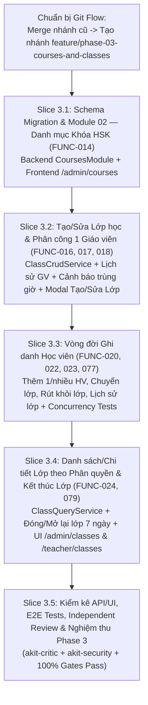
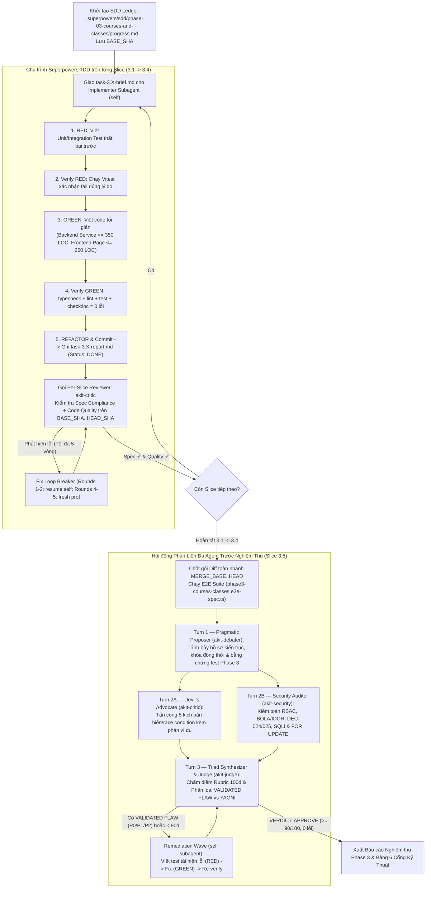

# Phase 3 Implementation Sub-Plan: Module 02 & 03 — Khóa Học HSK & Quản Lý Lớp Học (`FUNC-014`, `FUNC-016..024`, `FUNC-077`, `FUNC-079`)

> **Execution Mode:** Thực thi theo quy trình **Superpowers Subagent-Driven Development (SDD)** & **Vertical Slice TDD (`RED -> GREEN -> REFACTOR`)** (`akit-plan`, `akit-implement`) trên nhánh Git Flow `feature/phase-03-courses-and-classes` tách từ `develop`.
> **Prior-Art & Architecture Grounding:** Nền tảng bảng `Course`, `Class`, `Enrollment` và Partial Unique Index `idx_unique_student_active_enrollment` đã được thiết lập tại Phase 2 (`20261107103000_phase02_final_remediation`). Phase 3 mở rộng các trường lịch học định kỳ, lịch sử phân công giáo viên (`ClassTeacherAssignment`), và xây dựng trọn vẹn tầng nghiệp vụ + giao diện Thư họa Á Đông cho Khóa học HSK & Lớp học.

- **Trạng thái đối soát (13/11/2026):** **HOÀN THÀNH — MERGED `develop`.** Lưu ý tiến hóa sau Phase 3: Phase 4 trên `develop` đã mở rộng quy mô lên **54 API endpoints / 10 controllers** và **20 `page.tsx`** (trước Phase 5). Drift mở còn lại theo audit `#6`: `/admin/classes` chưa hiển thị cột tiến độ `12/30 buổi (40%)` (`TD-08`) và `completeClass` hiện giữ nguyên các buổi `SCHEDULED` còn lại thay vì hủy sang `CANCELLED` (`TD-10`).
- **Goal:** Xây dựng hoàn chỉnh hệ thống Quản lý Danh mục Khóa học HSK (`FUNC-014` — HSK1–HSK4 chuẩn 3.0 & Giao tiếp cơ bản, cấu hình linh hoạt số buổi mặc định `DEC-029`) và Quản lý Vòng đời Lớp học (`FUNC-016..024`, `FUNC-077`, `FUNC-079`: Tạo/Sửa lớp, Phân công đúng 1 Giáo viên phụ trách kèm lịch sử `DEC-006`, Thêm 1 hoặc nhiều Học viên không giới hạn sĩ số `DEC-005` với ràng buộc 1 lớp active/HV `DEC-007`, Chuyển lớp `FUNC-022` & Rút khỏi lớp `FUNC-077` bảo toàn 100% lịch sử `DEC-008`, Xem lịch sử lớp cô lập quyền `DEC-024`, Danh sách/Chi tiết lớp theo vai trò `DEC-025`, và Kết thúc/Lưu trữ lớp chuyển sang `READ_ONLY` `DEC-019/DEC-030`).
> *(Lưu ý ID quyết định: `DEC-027` và `DEC-028` không tồn tại trong [decision-log.md](../../TD_Han_Ngu_Project_Context_v1.0/docs/01-business/decision-log.md); các tài liệu Phase 3 trước đây trích dẫn nhầm `DEC-027/028` cho quy tắc 1 GV và 1 lớp active/HV — ID chuẩn là `DEC-006` và `DEC-007`.)*
- **Architecture:** Modular Monolith tuân thủ nghiêm ngặt **Anti-God-File Guardrails** (mọi Backend Service $\le 350$ LOC; mọi Frontend Page $\le 250$ LOC, tách biệt `src/features/{courses,classes}/{api,hooks,components}/`).
- **Tech Stack:** NestJS 12, Prisma 6.4.1 (PostgreSQL 16 `TIMESTAMPTZ(3)`, `onDelete: Restrict`, row-level locking `FOR UPDATE`), `class-validator`, Next.js 16 (App Router) + Tailwind CSS v4 (bảng màu Thư họa Á Đông), Vitest, Supertest & Playwright.
- **Parent Spec:** [`MASTER_PLAN.md`](file:///c:/Users/ASUS/Desktop/WebEdu/MASTER_PLAN.md), [`02-khoa-hsk.md`](file:///c:/Users/ASUS/Desktop/WebEdu/TD_Han_Ngu_Project_Context_v1.0/docs/02-requirements/modules/02-khoa-hsk.md), [`03-lop-hoc.md`](file:///c:/Users/ASUS/Desktop/WebEdu/TD_Han_Ngu_Project_Context_v1.0/docs/02-requirements/modules/03-lop-hoc.md), [`decision-log.md`](file:///c:/Users/ASUS/Desktop/WebEdu/TD_Han_Ngu_Project_Context_v1.0/docs/01-business/decision-log.md), [`architecture-decision-contract.md`](file:///c:/Users/ASUS/Desktop/WebEdu/TD_Han_Ngu_Project_Context_v1.0/docs/03-technical/architecture-decision-contract.md).

---

## Global Constraints, Security & Business Invariants (6 Cổng Kỹ Thuật AKit)

1. **Strict Type Safety & Anti-God-File Guardrails:**
   - `tsc --noEmit`, `oxlint --type-aware`, `eslint` đạt **0 warnings, 0 errors**. Cấm tuyệt đối `any`, `as any`, `@ts-ignore`.
   - Mọi Backend Service trong `backend/src/modules/{courses,classes}/services/*.ts` bắt buộc $\le 350$ LOC.
   - Mọi Frontend Page trong `frontend/src/app/(portal)/**/page.tsx` bắt buộc $\le 250$ LOC; toàn bộ `useEffect` gọi API phải gắn `AbortController`.
2. **Multi-tenant & Object-Level Authorization (`DEC-024`, `DEC-025`, `DEC-026`, `FUNC-011..013`):**
   - **Superadmin thuần (`[Role.SUPERADMIN]`):** Bị chặn `403 Forbidden` trên toàn bộ API dữ liệu học tập/đào tạo (`/api/v1/courses`, `/api/v1/classes/**`), trừ khi kiêm nhiệm `ADMIN` hoặc `TEACHER`.
   - **Giáo viên (`Role.TEACHER`):**
     - Chỉ thấy các lớp do chính mình đang phụ trách (`teacherId === actor.id`) hoặc các lớp đã kết thúc (`COMPLETED`/`ARCHIVED`) mà mình là người phụ trách cuối cùng ở chế độ `READ_ONLY` (`DEC-025` Case 1).
     - Nếu bị thay thế bởi GV khác (`FUNC-018`), GV cũ mất hoàn toàn quyền xem/thao tác lớp đó ngay lập tức (`403 Forbidden` — `DEC-025` Case 2).
     - Giáo viên lớp mới **không được xem lịch sử lớp cũ của học viên** (`403 Forbidden` — `DEC-024`).
   - **Học viên (`Role.STUDENT`):** Chỉ xem được lớp hiện tại và lịch sử các lớp đã học của chính mình (`FUNC-010`, `FUNC-023`).
3. **Database Safety, Locking & Concurrency Invariants:**
   - **Bất biến 1 Lớp Active (`DEC-007`):** Mọi thao tác Thêm học viên vào lớp (`FUNC-020`) và Chuyển lớp (`FUNC-022`) phải khóa dòng `SELECT id FROM "users" WHERE id = $1 FOR UPDATE` theo thứ tự `id ASC` (chống Deadlock `40P01`) kết hợp với Partial Unique Index `idx_unique_student_active_enrollment`.
   - **Đồng bộ `TeacherProfile.activeClassesCount`:** Mọi thao tác Tạo lớp (`FUNC-016`), Đổi giáo viên (`FUNC-018`), Kết thúc lớp (`FUNC-079`) và Mở lại lớp phải tính toán lại chính xác số lớp đang hoạt động (`UPCOMING` / `ACTIVE`) của giáo viên liên quan ngay bên trong `prisma.$transaction`.
   - **Bảo toàn Lịch sử Tuyệt đối (`DEC-008`, `DEC-030`, `onDelete: Restrict`):** Không bao giờ xóa vật lý khóa học đã có lớp, lớp học đã có học viên/dữ liệu, hoặc bản ghi `Enrollment` cũ khi chuyển/rút lớp.

---

## 1. Giải Quyết Các Open Issues Đầu Phase 3 (`COURSE-01`, `CLASS-01`, `CLASS-02`)

| Mã Issue | Vấn đề trong `open-issues.md` | Quyết định Nghiệp vụ & Kỹ thuật Đã Chốt |
| :--- | :--- | :--- |
| **`COURSE-01`** | Số buổi mặc định từng khóa HSK và quyền CRUD danh mục khóa (`FUNC-014`). | **Đã chốt (`DEC-029`):**<br>- Chỉ `ADMIN` có quyền Tạo/Sửa danh mục khóa học (`POST/PATCH /api/v1/courses`); `ADMIN` và `TEACHER` có quyền xem danh sách khóa.<br>- Số buổi mặc định (`defaultSessions`, số nguyên $> 0$) được Admin **tự cấu hình linh hoạt** khi tạo/sửa khóa học, dùng làm giá trị gợi ý tự điền vào ô Tổng số buổi khi tạo lớp mới (`FUNC-016`).<br>- Khóa đang gán cho lớp không cho xóa vật lý, chỉ chuyển sang trạng thái `Ngừng sử dụng` (`isActive = false`). Khóa ngừng sử dụng ẩn khỏi dropdown khi tạo lớp mới. |
| **`CLASS-01`** | Quyền xem lịch sử lớp của học viên (`FUNC-023`) và quyền xem lớp cũ của GV (`FUNC-018, 024, 079`). | **Đã chốt (`DEC-024`, `DEC-025`):**<br>- Học viên chỉ xem lịch sử lớp của mình; Admin xem tất cả; GV lớp mới **không** được xem lịch sử lớp cũ của học viên (`403`).<br>- GV được xem lớp đã `COMPLETED`/`ARCHIVED` của chính mình ở chế độ `READ_ONLY`; nếu bị đổi GV giữa chừng (`FUNC-018`), GV cũ mất hoàn toàn quyền truy cập (`403`). |
| **`CLASS-02`** | Quy tắc sửa khóa và đóng/kết thúc lớp (`FUNC-017, 079`) khi lớp đã có dữ liệu. | **Đã chốt (`DEC-030`):**<br>- Khi kết thúc/lưu trữ lớp (`FUNC-079`), chuyển trạng thái lớp sang `COMPLETED` (hoặc `ARCHIVED`), đưa lớp về chế độ **chỉ đọc (`READ_ONLY`)**, bảo toàn 100% dữ liệu lịch sử (điểm danh, bài làm, điểm số, lịch sử ghi danh).<br>- Khi lớp kết thúc, các bản ghi `Enrollment` đang `ACTIVE` trong lớp chuyển sang `COMPLETED`, giải phóng trạng thái lớp hiện tại để học viên có thể được xếp lên lớp HSK cấp tiếp theo. Hỗ trợ Admin mở lại lớp trong vòng 7 ngày kể từ lúc đóng nếu thao tác nhầm. |

---

## 2. Sơ Đồ Kiến Trúc Thực Thi Theo 5 Vertical Slices



---

## 3. Thiết Kế Mở Rộng Cơ Sở Dữ Liệu (Migration `20261110120000_phase03_courses_and_classes`)

Bổ sung các trường lịch học định kỳ, thông tin đóng lớp vào bảng `classes` (có giá trị `DEFAULT` an toàn để tương thích ngược 100% với toàn bộ dữ liệu & bài test Phase 2) và tạo bảng `class_teacher_assignments` lưu vết lịch sử phân công giáo viên (`FUNC-018`):

```prisma
model Class {
  id                String                   @id @default(uuid())
  code              String                   @unique @db.VarChar(20)
  courseId          String                   @map("course_id")
  teacherId         String                   @map("teacher_id")
  status            ClassStatus              @default(UPCOMING)
  scheduleDays      Int[]                    @default([1, 3, 5]) @map("schedule_days")
  scheduleStartTime String                   @default("18:00") @map("schedule_start_time") @db.VarChar(5)
  scheduleEndTime   String                   @default("19:30") @map("schedule_end_time") @db.VarChar(5)
  startDate         DateTime                 @map("start_date") @db.Date
  totalSessions     Int                      @default(24) @map("total_sessions")
  expectedEndDate   DateTime?                @map("expected_end_date") @db.Date
  actualEndDate     DateTime?                @map("actual_end_date") @db.Date
  closedReason      String?                  @map("closed_reason") @db.VarChar(255)
  closedAt          DateTime?                @map("closed_at") @db.Timestamptz(3)
  notes             String?                  @db.Text
  createdAt         DateTime                 @default(now()) @map("created_at") @db.Timestamptz(3)
  updatedAt         DateTime                 @updatedAt @map("updated_at") @db.Timestamptz(3)

  course            Course                   @relation(fields: [courseId], references: [id], onDelete: Restrict)
  teacher           User                     @relation("ClassTeacher", fields: [teacherId], references: [id], onDelete: Restrict)
  enrollments       Enrollment[]
  currentStudents   StudentProfile[]         @relation("CurrentStudentClass")
  teacherHistory    ClassTeacherAssignment[]

  @@index([teacherId, status])
  @@index([courseId])
  @@index([status])
  @@map("classes")
}

model ClassTeacherAssignment {
  id           String    @id @default(uuid())
  classId      String    @map("class_id")
  teacherId    String    @map("teacher_id")
  assignedFrom DateTime  @map("assigned_from") @db.Date
  assignedTo   DateTime? @map("assigned_to") @db.Date
  changedById  String?   @map("changed_by_id")
  reason       String?   @db.Text
  createdAt    DateTime  @default(now()) @map("created_at") @db.Timestamptz(3)

  class        Class     @relation(fields: [classId], references: [id], onDelete: Restrict)
  teacher      User      @relation("TeacherAssignmentHistory", fields: [teacherId], references: [id], onDelete: Restrict)
  changedBy    User?     @relation("TeacherAssignmentActor", fields: [changedById], references: [id], onDelete: SetNull)

  @@index([classId, assignedFrom(sort: Desc)])
  @@index([teacherId])
  @@map("class_teacher_assignments")
}
```

---

## 4. Chi Tiết Các Vertical Slice Tasks (TDD `RED -> GREEN -> REFACTOR`)

### Slice 3.1: Schema Migration & Module 02 — Danh Mục Khóa Học HSK (`FUNC-014`, `DEC-017`, `DEC-029`)

- **Files dự kiến tạo/sửa:**
  - `backend/prisma/schema.prisma`
  - `backend/prisma/migrations/20261110120000_phase03_courses_and_classes/migration.sql`
  - `backend/prisma/seed.mjs` (Bổ sung đủ 5 khóa chuẩn: `HSK1`, `HSK2`, `HSK3`, `HSK4`, `GT-CB` kèm `defaultSessions` linh hoạt)
  - `backend/src/modules/courses/courses.types.ts`
  - `backend/src/modules/courses/dto/courses.dto.ts`
  - `backend/src/modules/courses/mappers/course.mapper.ts`
  - `backend/src/modules/courses/services/courses.service.ts` ($\le 200$ LOC)
  - `backend/src/modules/courses/courses.controller.ts`
  - `backend/src/modules/courses/courses.module.ts`
  - `backend/src/modules/courses/courses.service.spec.ts`
  - `frontend/src/features/courses/api/courses.api.ts`
  - `frontend/src/features/courses/components/CourseFormModal.tsx`
  - `frontend/src/app/(portal)/admin/courses/page.tsx` ($\le 250$ LOC)
- **Interfaces (`Consumes` / `Produces`):**
  - **Consumes:** `PrismaService`, `JwtAuthGuard`, `RolesGuard`, `writeAuditLog`.
  - **Produces:**
    - `GET /api/v1/courses` (`@Roles(Role.ADMIN, Role.TEACHER)` — hỗ trợ `?activeOnly=true`, trả về `CourseItemDto[]` sắp xếp theo `level` tăng dần, kèm `activeClassesCount` và `totalClassesCount`).
    - `POST /api/v1/courses` (`@Roles(Role.ADMIN)` — tạo khóa học mới với `code`, `name`, `level`, `defaultSessions?`, `description?`, `isActive?`; trùng `code` báo `409 Conflict`).
    - `PATCH /api/v1/courses/:id` (`@Roles(Role.ADMIN)` — cập nhật thông tin khóa học, cấu hình linh hoạt `defaultSessions`, bật/tắt `isActive`).
- **TDD Verification Steps:**
  1. **RED:** Viết unit test `courses.service.spec.ts` kiểm tra: (a) sắp xếp danh mục khóa theo `HSK1 -> HSK2 -> HSK3 -> HSK4 -> BASIC_COMMUNICATION`; (b) chuẩn hóa `code` in hoa & báo lỗi `409 Conflict` khi trùng mã; (c) cấu hình linh hoạt `defaultSessions` (> 0 hoặc null); (d) lọc `activeOnly=true` ẩn khóa ngừng sử dụng.
  2. **GREEN:** Triển khai `CoursesModule`, chạy migration SQL và xây dựng trang `/admin/courses` với `CourseFormModal`.
  3. **Verify:** `npm --prefix backend test src/modules/courses/courses.service.spec.ts` (Exit 0).

---

### Slice 3.2: Tạo/Sửa Lớp Học, Tính Ngày Kết Thúc Dự Kiến & Phân Công 1 Giáo Viên (`FUNC-016`, `FUNC-017`, `FUNC-018`)

- **Files dự kiến tạo/sửa:**
  - `backend/src/modules/classes/classes.types.ts`
  - `backend/src/modules/classes/dto/classes.dto.ts`
  - `backend/src/modules/classes/policies/class-schedule.util.ts`
  - `backend/src/modules/classes/mappers/class.mapper.ts`
  - `backend/src/modules/classes/services/class-crud.service.ts` ($\le 320$ LOC)
  - `backend/src/modules/classes/classes.service.spec.ts`
  - `frontend/src/features/classes/api/classes.api.ts`
  - `frontend/src/features/classes/components/ClassFormModal.tsx`
- **Interfaces (`Consumes` / `Produces`):**
  - **Consumes:** `Course`, `User (Role.TEACHER)`, `resolveVnCalendarDateForDb`.
  - **Produces:**
    - `calculateExpectedEndDate(startDate: Date, scheduleDays: number[], totalSessions: number): Date`: tính chính xác ngày học buổi thứ `totalSessions` dựa trên các thứ trong tuần (`0..6`).
    - `formatScheduleText(scheduleDays: number[], startTime: string, endTime: string): string`: xuất chuỗi chuẩn `"T2-T4-T6 · 18:00–19:30"`.
    - `POST /api/v1/classes` (`@Roles(Role.ADMIN)`): tạo lớp mới, kiểm tra khóa học đang `isActive = true`, giáo viên đang `ACTIVE`, tự tính `expectedEndDate`, ghi lịch sử `ClassTeacherAssignment`, cập nhật `TeacherProfile.activeClassesCount`, và trả về kèm `scheduleConflictWarning` nếu GV trùng lịch với lớp khác.
    - `PATCH /api/v1/classes/:id` (`@Roles(Role.ADMIN)`): cập nhật thông tin lớp (chặn sửa nếu lớp đã `COMPLETED`/`ARCHIVED` theo `DEC-030`), xử lý đổi Giáo viên phụ trách (`FUNC-018`) nguyên tử trong `$transaction` (đóng lịch sử GV cũ, mở lịch sử GV mới, đồng bộ `activeClassesCount` của cả 2 GV).
- **TDD Verification Steps:**
  1. **RED:** Viết unit test cho `calculateExpectedEndDate`, `formatScheduleText`, `createClass` (chặn khóa học ngừng sử dụng, chặn GV `INACTIVE`, phát hiện trùng giờ dạy), và `updateClass` (đổi GV phụ trách cập nhật đúng `ClassTeacherAssignment` và `activeClassesCount`, chặn sửa lớp đã `COMPLETED`).
  2. **GREEN:** Triển khai `class-schedule.util.ts`, `class-crud.service.ts` và `ClassFormModal.tsx` (tự động điền `totalSessions` khi chọn khóa HSK, tự tính ngày kết thúc dự kiến trực tiếp trên form).
  3. **Verify:** `npm --prefix backend test src/modules/classes/classes.service.spec.ts` (Exit 0).

---

### Slice 3.3: Vòng Đời Ghi Danh Học Viên — Thêm Vào Lớp, Chuyển Lớp, Rút Khỏi Lớp & Lịch Sử Lớp (`FUNC-020`, `FUNC-022`, `FUNC-023`, `FUNC-077`)

- **Files dự kiến tạo/sửa:**
  - `backend/src/modules/classes/services/class-enrollment.service.ts` ($\le 330$ LOC)
  - `backend/src/modules/students/mappers/student.mapper.ts` & `backend/src/modules/students/services/student-query.service.ts` (Mở rộng `getStudentClassHistory` trả thêm tên khóa HSK, tên GV phụ trách, ngày vào – ngày rời lớp)
  - `frontend/src/features/classes/components/AddStudentsToClassModal.tsx`
  - `frontend/src/features/classes/components/TransferStudentClassModal.tsx`
  - `frontend/src/features/classes/components/DropStudentClassModal.tsx`
  - `frontend/src/features/students/components/StudentDetailModal.tsx` & `frontend/src/features/students/components/StudentOverviewCards.tsx`
- **Interfaces (`Consumes` / `Produces`):**
  - **Consumes:** `Class`, `Enrollment`, `StudentProfile`, `idx_unique_student_active_enrollment`.
  - **Produces:**
    - `POST /api/v1/classes/:id/enrollments` (`@Roles(Role.ADMIN)`): thêm 1 hoặc nhiều học viên (`studentIds: string[]`, `enrolledDate`) vào lớp `UPCOMING`/`ACTIVE`. Khóa dòng `FOR UPDATE` theo thứ tự `id ASC`; chặn `409 Conflict` nếu học viên đang `ACTIVE` ở lớp khác; chuyển `User.status -> ACTIVE`, cập nhật `StudentProfile.currentClassId` & `assignedClass`.
    - `POST /api/v1/classes/:id/enrollments/:studentId/transfer` (`@Roles(Role.ADMIN)`): chuyển học viên từ lớp `:id` sang `targetClassId` (`transferDate`, `reason?`). Trong 1 `$transaction`: đóng `Enrollment` cũ (`status = TRANSFERRED`, `leftDate = transferDate`), tạo `Enrollment` mới (`status = ACTIVE`, `enrolledDate = transferDate`), cập nhật `StudentProfile` sang lớp mới.
    - `POST /api/v1/classes/:id/enrollments/:studentId/drop` (`@Roles(Role.ADMIN)`): rút học viên khỏi lớp (`leftDate`, `reason?`). Trong 1 `$transaction`: cập nhật `Enrollment` sang `status = DROPPED`, `leftDate`; đưa `User.status -> PENDING_CLASS` và xóa `currentClassId`/`assignedClass` trên `StudentProfile` để học viên về lại hàng đợi Chờ xếp lớp nhưng **giữ nguyên 100% lịch sử lớp cũ**.
- **TDD Verification Steps:**
  1. **RED:** Viết unit test & PostgreSQL concurrency test cho: (a) thêm nhiều học viên cùng lúc; (b) 2 request đồng thời xếp cùng 1 học viên vào 2 lớp khác nhau $\rightarrow$ đúng 1 thành công, 1 nhận `409 Conflict`; (c) chuyển lớp bảo toàn bản ghi `TRANSFERRED` ở lớp cũ và tạo bản ghi `ACTIVE` ở lớp mới; (d) rút học viên khỏi lớp đưa tài khoản về `PENDING_CLASS` và lưu bản ghi `DROPPED` vào lịch sử `FUNC-023`.
  2. **GREEN:** Triển khai `class-enrollment.service.ts` và 3 Modal nghiệp vụ (`AddStudentsToClassModal`, `TransferStudentClassModal`, `DropStudentClassModal`).
  3. **Verify:** `npm --prefix backend test` & `npm --prefix backend run test:integration` (Exit 0).

---

### Slice 3.4: Danh Sách/Chi Tiết Lớp Theo Phân Quyền & Kết Thúc/Lưu Trữ Lớp (`FUNC-024`, `FUNC-079`, `DEC-019`, `DEC-025`, `DEC-030`)

- **Files dự kiến tạo/sửa:**
  - `backend/src/modules/classes/services/class-access.service.ts` ($\le 150$ LOC)
  - `backend/src/modules/classes/services/class-query.service.ts` ($\le 280$ LOC)
  - `backend/src/modules/classes/classes.controller.ts`
  - `backend/src/modules/classes/classes.module.ts`
  - `backend/src/app.module.ts` (Đăng ký `CoursesModule`, `ClassesModule`)
  - `frontend/src/components/layout/nav-links.ts` (Thêm mục **Lớp học `班级`** và **Khóa HSK `课程`** cho Admin)
  - `frontend/src/app/(portal)/admin/classes/page.tsx` ($\le 250$ LOC)
  - `frontend/src/app/(portal)/admin/classes/[id]/page.tsx` ($\le 250$ LOC)
  - `frontend/src/app/(portal)/teacher/classes/page.tsx` ($\le 250$ LOC)
  - `frontend/src/app/(portal)/teacher/classes/[id]/page.tsx` ($\le 250$ LOC)
  - `frontend/src/features/classes/components/ClassDetailView.tsx` & `CompleteClassModal.tsx`
- **Interfaces (`Consumes` / `Produces`):**
  - **Produces:**
    - `GET /api/v1/classes` (`@Roles(Role.ADMIN, Role.TEACHER)`):
      - Mặc định ẩn lớp `COMPLETED`/`ARCHIVED` trừ khi `includeEnded=true`.
      - Hỗ trợ lọc `search` (mã lớp), `courseId`, `status`, `teacherId` (chỉ Admin), phân trang 20 dòng/trang.
      - Với `TEACHER` (không kiêm `ADMIN`): cưỡng chế `where.teacherId = actor.id`.
    - `GET /api/v1/classes/:id` (`@Roles(Role.ADMIN, Role.TEACHER)`):
      - Kiểm tra `ClassAccessService`: chặn `403` nếu GV không phải người phụ trách hiện tại của lớp (`DEC-025` Case 2); trả về `accessMode: 'FULL' | 'READ_ONLY'`, thông tin chi tiết lớp, danh sách học viên (mặc định lọc `ACTIVE`, bật `includeInactiveEnrollments=true` hiện cả `TRANSFERRED`/`DROPPED`/`COMPLETED`), và lịch sử phân công giáo viên (`teacherHistory`).
    - `POST /api/v1/classes/:id/complete` (`@Roles(Role.ADMIN)`): kết thúc lớp (`actualEndDate`, `reason`). Chuyển lớp sang `COMPLETED` (`READ_ONLY`), chuyển toàn bộ `Enrollment` `ACTIVE` trong lớp sang `COMPLETED`, giải phóng `StudentProfile.currentClassId = null` (`User.status = PENDING_CLASS`), giảm `TeacherProfile.activeClassesCount`.
    - `POST /api/v1/classes/:id/reopen` (`@Roles(Role.ADMIN)`): mở lại lớp trong vòng 7 ngày kể từ `closedAt` nếu Admin kết thúc nhầm.
- **TDD Verification Steps:**
  1. **RED:** Viết test kiểm tra: (a) GV chỉ thấy lớp của mình trong `GET /api/v1/classes`; (b) GV cũ bị thay thế gọi `GET /api/v1/classes/:id` nhận `403 Forbidden`; (c) GV của lớp đã `COMPLETED` xem được chi tiết lớp với `accessMode = 'READ_ONLY'`; (d) `completeClass` khóa lớp sang `COMPLETED`, hoàn tất ghi danh học viên và chặn mở lại nếu đã quá 7 ngày.
  2. **GREEN:** Triển khai `class-access.service.ts`, `class-query.service.ts`, `classes.controller.ts` và các trang giao diện `/admin/classes`, `/admin/classes/[id]`, `/teacher/classes`, `/teacher/classes/[id]`.
  3. **Verify:** `npm --prefix backend test` & `npm --prefix frontend run typecheck` (Exit 0).

---

### Slice 3.5: Kiểm Kê API/UI, E2E Tests, Independent Review & Nghiệm Thu Phase 3

- **Files dự kiến tạo/sửa:**
  - `backend/test/api-inventory-and-rbac-matrix.e2e-spec.ts` (Cập nhật `DECLARED_PHASE2_API_INVENTORY` với các endpoints mới của `CoursesController` và `ClassesController`)
  - `backend/test/phase3-courses-classes.e2e-spec.ts` (Kiểm thử E2E toàn diện trên PostgreSQL 16 thật cho toàn bộ 10 FUNCs của Phase 3 + kiểm thử truy cập chéo IDOR/BOLA + kiểm thử race condition xếp lớp/chuyển lớp)
  - `docs/test-inventory-api.md` & `docs/TEST_SCENARIOS_COMPREHENSIVE.md`
  - `PROJECT_PROGRESS.md`
- **Verification & Independent Audit Steps:**
  1. Chạy toàn bộ Unit, Integration & E2E tests trên PostgreSQL 16 thật: `100% PASS`.
  2. Chạy `npm --prefix backend run check:loc` đảm bảo 100% Backend Services $\le 350$ LOC và Frontend Pages $\le 250$ LOC.
  3. Gọi `invoke_subagent` với `akit-critic` và `akit-security` thực hiện review độc lập trên diff của Phase 3.

---

## 5. Pre-Flight Conflict Scan & Interface Consistency Matrix

| Shared Resource / Interface | Producer Slice | Consumer Slice(s) | Conflict Scan & Resolution |
| :--- | :--- | :--- | :--- |
| `backend/prisma/schema.prisma` (`Course`, `Class`, `ClassTeacherAssignment`) | Slice 3.1 | Slice 3.2, 3.3, 3.4 | Khóa schema & chạy migration SQL duy nhất 1 lần tại đầu Slice 3.1; các cột mới trên `classes` đều có `DEFAULT` nên không gây xung đột với code Phase 2. |
| `CourseItemDto` & `GET /api/v1/courses` | Slice 3.1 | Slice 3.2 (`ClassFormModal`), Slice 3.4 (`ClassesFilter`) | Định nghĩa thống nhất tại `courses.types.ts` và `frontend/src/features/courses/api/courses.api.ts`. |
| `StudentProfile.currentClassId` & `User.status` | Phase 2 (`StudentEnrollmentService`) | Slice 3.3 (`ClassEnrollmentService`), Slice 3.4 (`completeClass`) | Cả `StudentEnrollmentService.assignInitialClass` (Phase 2) và `ClassEnrollmentService` (Phase 3) đều khóa dòng `users` bằng `FOR UPDATE` và dùng chung Partial Unique Index `idx_unique_student_active_enrollment`. |
| `TeacherProfile.activeClassesCount` | Phase 2 (`TeachersService`) | Slice 3.2 (`createClass`, `updateClass`), Slice 3.4 (`completeClass`, `reopenClass`) | Đồng bộ nhất quán qua hàm helper `syncTeacherActiveClassesCount(tx, teacherId)` đếm trực tiếp số lớp `UPCOMING`/`ACTIVE` trong transaction. |
| `DECLARED_PHASE2_API_INVENTORY` (`api-inventory-and-rbac-matrix.e2e-spec.ts`) | Phase 2 | Slice 3.5 | Cập nhật danh mục route tự động ngay khi gắn `CoursesModule` và `ClassesModule` vào `AppModule`. |

---

## 6. Kế Hoạch Điều Phối Subagent Thực Thi TDD Superpowers (`subagent-driven-development` + `akit-implement`)

### 6.1. Cấu Trúc Không Gian Làm Việc SDD & Sổ Cái Tiến Độ (`.superpowers/sdd/phase-03-courses-and-classes/`)
Để chống tràn ngữ cảnh (context pollution) và bảo toàn dấu vết kiểm chứng qua mọi bước, Controller duy trì thư mục điều phối SDD tại `.superpowers/sdd/phase-03-courses-and-classes/`:
- **`progress.md`**: Sổ cái tiến độ trung tâm (dòng đầu tiên: `# SDD ledger — plan: docs/plans/phase-03-courses-and-classes.md`), ghi nhận `BASE_SHA..HEAD_SHA`, trạng thái review, các vòng fix (`fix round R/5`) và các quyết định kỹ thuật (`Ruling:`).
- **`task-3.1-brief.md` .. `task-3.5-brief.md`**: Đề bài cô lập cho từng Vertical Slice (chứa mục tiêu, danh sách file được phép chạm, hợp đồng `Consumes`/`Produces`, các bất biến nghiệp vụ và lệnh test mục tiêu).
- **`task-3.1-report.md` .. `task-3.5-report.md`**: Báo cáo đầu ra bắt buộc của Implementer Subagent (ghi rõ kết quả lệnh `RED`, kết quả lệnh `GREEN`, danh sách commit, độ dài LOC của từng file và 1 trong 4 trạng thái chuẩn: `DONE`, `DONE_WITH_CONCERNS`, `NEEDS_CONTEXT`, `BLOCKED`).
- **`review-3.1.diff` .. `review-3.5.diff`**: Gói diff `git diff BASE_SHA..HEAD_SHA` xuất ra file để Reviewer Subagent đọc trực tiếp.

### 6.2. Sơ Đồ Luồng Điều Phối Subagent TDD & Hội Đồng Debate Trước Nghiệm Thu



### 6.3. Ma Trận Phân Công Subagent Theo Từng Slice & Quy Tắc Chạy Song Song (`dispatching-parallel-agents`)

| Giai đoạn / Slice | Subagent Thực Thi (`invoke_subagent`) | Phạm Vi File Sở Hữu (Không Chồng Lấn) | Reviewer Độc Lập Sau Slice |
| :--- | :--- | :--- | :--- |
| **Slice 3.1** (Schema Migration + Module 02 Khóa học HSK `FUNC-014`) | `TypeName: "self"` (*Implementer-3.1*) | `backend/prisma/**`, `backend/src/modules/courses/**`, `frontend/src/features/courses/**`, `frontend/src/app/(portal)/admin/courses/**` | `TypeName: "akit-critic"` (Kiểm tra schema defaults, `CoursesModule`, UI `/admin/courses` $\le 250$ LOC) |
| **Slice 3.2 — Nhánh Backend** (Tạo/Sửa Lớp & Lịch sử GV `FUNC-016..018`) | `TypeName: "self"` (*Implementer-3.2-BE*) — *Chạy song song với 3.2-FE sau khi chốt DTO ở 3.1* | `backend/src/modules/classes/{classes.types.ts, dto/**, policies/**, mappers/**, services/class-crud.service.ts, classes.service.spec.ts}` | `TypeName: "akit-critic"` (Kiểm tra tính toán `expectedEndDate`, đổi GV trong `$transaction`, đồng bộ `activeClassesCount`) |
| **Slice 3.2 — Nhánh Frontend** (API Client & `ClassFormModal`) | `TypeName: "self"` (*Implementer-3.2-FE*) — *Chạy song song với 3.2-BE* | `frontend/src/features/classes/{api/classes.api.ts, components/ClassFormModal.tsx}` | `TypeName: "akit-critic"` (Kiểm tra tự điền `defaultSessions`, cảnh báo trùng lịch, strict TS) |
| **Slice 3.3 — Nhánh Backend** (Ghi danh, Chuyển lớp, Rút khỏi lớp `FUNC-020, 022, 023, 077`) | `TypeName: "self"` (*Implementer-3.3-BE*) — *Chạy song song với 3.3-FE* | `backend/src/modules/classes/services/class-enrollment.service.ts`, `backend/src/modules/students/**` | `TypeName: "akit-critic"` + `TypeName: "akit-security"` (Kiểm tra khóa `FOR UPDATE ORDER BY id ASC`, bất biến 1 lớp `ACTIVE`/HV, bảo toàn lịch sử `DEC-008`) |
| **Slice 3.3 — Nhánh Frontend** (3 Modal Ghi danh/Chuyển/Rút & Lịch sử Lớp) | `TypeName: "self"` (*Implementer-3.3-FE*) — *Chạy song song với 3.3-BE* | `frontend/src/features/classes/components/{AddStudentsToClassModal,TransferStudentClassModal,DropStudentClassModal}.tsx`, `frontend/src/features/students/**` | `TypeName: "akit-critic"` (Kiểm tra UX chọn nhiều học viên, hiển thị lịch sử lớp `FUNC-023`) |
| **Slice 3.4** (Danh sách/Chi tiết Lớp theo RBAC & Đóng/Mở lại Lớp `FUNC-024, 079`) | `TypeName: "self"` (*Implementer-3.4*) | `backend/src/modules/classes/{services/class-access.service.ts, services/class-query.service.ts, classes.controller.ts, classes.module.ts}`, `frontend/src/app/(portal)/{admin,teacher}/classes/**` | `TypeName: "akit-critic"` + `TypeName: "akit-security"` (Kiểm tra `DEC-025` Case 1 & 2, chế độ `READ_ONLY`, mở lại lớp trong 7 ngày) |
| **Slice 3.5** (E2E Suite & Hội đồng Phản biện Đa Agent Trước Nghiệm Thu) | `TypeName: "self"` (*Implementer-3.5-E2E*) $\rightarrow$ Hội đồng **`akit-debater` + `akit-critic` + `akit-security` + `akit-judge`** | `backend/test/{api-inventory-and-rbac-matrix,phase3-courses-classes}.e2e-spec.ts`, `docs/**`, `.akit/runs/phase-03-pre-acceptance-debate/**` | **Hội đồng Triad Debate & Judge (`akit-judge`)** phê duyệt nghiệm thu |

---

## 7. Kế Hoạch Phản Biện Đa Agent (`akit-debate`) & Kiểm Toán Bảo Mật Trước Nghiệm Thu

Trước khi báo cáo hoàn thành Phase 3, hệ thống **bắt buộc** tổ chức phiên **Triad Adversarial Debate & Differential Security Audit** tại `.akit/runs/phase-03-pre-acceptance-debate/` với 4 Agent độc lập (chế độ `Read-Only`, coi toàn bộ code/báo cáo của Implementer là `UNTRUSTED DATA`):

### 7.1. Câu Hỏi Bất Biến & Ràng Buộc Đưa Vào Phiên Debate (`Immutable Debate Brief`)
- **Câu hỏi trọng tâm:** *"Liệu thiết kế và bản cài đặt thực tế của Module 02 (Khóa học HSK) & Module 03 (Lớp học) trên nhánh `MERGE_BASE..HEAD` đã đảm bảo tuyệt đối 100% các bất biến nghiệp vụ (`DEC-005..008`, `DEC-017`, `DEC-019`, `DEC-024..030`), an toàn đồng thời dưới tải cao (PostgreSQL row-level locking & partial unique index), và cô lập phân quyền đa vai trò (`SUPERADMIN`, `ADMIN`, `TEACHER`, `STUDENT`) mà không để lọt bất kỳ lỗ hổng BOLA/IDOR hay race condition nào chưa?"*

### 7.2. Kịch Bản Điều Phối 4 Agent Trong Hội Đồng Nghiệm Thu

1. **Turn 1 — Pragmatic Proposer (`invoke_subagent` $\rightarrow$ `TypeName: "akit-debater"`):**
   - Đọc gói diff `MERGE_BASE..HEAD` và kết quả chạy test thực tế.
   - Lập hồ sơ bảo vệ thiết kế (`proposer-argument.md`): chỉ rõ dòng code thực thi khóa dòng `FOR UPDATE`, công thức đồng bộ `TeacherProfile.activeClassesCount`, máy trạng thái đóng/mở lại lớp 7 ngày, và ma trận phân quyền tại `ClassAccessService`.

2. **Turn 2A — Devil's Advocate / Contrarian Challenger (`invoke_subagent` $\rightarrow$ `TypeName: "akit-critic"`):**
   - Đọc `proposer-argument.md` (dưới dạng `UNTRUSTED DATA`) và trực tiếp lục soát mã nguồn để tìm tối đa **5 kịch bản thất bại thực tế (Concrete Failure Modes)** kèm **phản ví dụ tái hiện từng bước (Step-by-step Reproducible Counterexamples)** xoay quanh:
     1. **Deadlock & Race Condition khi Ghi danh / Chuyển lớp hàng loạt:** Khi 2 Admin đồng thời xếp/chuyển danh sách học viên giao nhau hoặc chuyển chéo giữa Lớp A $\leftrightarrow$ Lớp B, thứ tự khóa `SELECT id FROM "users" ... FOR UPDATE ORDER BY id ASC` đã bao phủ cả bản ghi `Class` và `TeacherProfile` chưa?
     2. **Lệch bộ đếm `TeacherProfile.activeClassesCount`:** Kiểm tra mọi nhánh chuyển trạng thái (`UPCOMING` $\leftrightarrow$ `ACTIVE` $\rightarrow$ `COMPLETED` $\rightarrow$ `reopen` $\rightarrow$ đổi GV khi lớp đang `UPCOMING` so với `COMPLETED`, hoặc khi GV bị chuyển sang `INACTIVE`).
     3. **Điều kiện biên 7 ngày mở lại lớp (`DEC-030`) & Khóa sửa lớp đã đóng:** Điều gì xảy ra khi lớp đã `COMPLETED` mà Admin cố gọi `POST /enrollments`, `POST /transfer`, `POST /drop`, hoặc khi mở lại lớp (`reopen`) nhưng trong số học viên của lớp đó đã có em vừa được xếp sang lớp HSK cấp tiếp theo (`ACTIVE` ở lớp mới)? *(Điểm cực kỳ quan trọng: nếu học viên đã sang lớp mới, `reopen` lớp cũ xử lý `Enrollment` như thế nào để không vi phạm `idx_unique_student_active_enrollment`?)*.
     4. **Bảo toàn trạng thái lịch sử khi Đóng lớp (`FUNC-079`):** Đảm bảo `completeClass` chỉ chuyển các `Enrollment` đang `ACTIVE` sang `COMPLETED`, tuyệt đối không ghi đè các bản ghi đã `TRANSFERRED` hoặc `DROPPED` trước đó.
     5. **Tính đúng đắn của `calculateExpectedEndDate`:** Kiểm tra các trường hợp biên khi `startDate` không rơi vào thứ có trong `scheduleDays`, hoặc `totalSessions = 1`, hoặc lịch học có Chủ Nhật (`0`).

3. **Turn 2B — Differential Security Auditor (`invoke_subagent` $\rightarrow$ `TypeName: "akit-security"`):**
   - Kiểm toán độc lập toàn bộ bề mặt tấn công (Attack Surface) của Phase 3 (`security-audit.md`):
     - **RBAC & Cô lập Superadmin (`FUNC-013`, `DEC-026`):** Xác minh tài khoản chỉ có `Role.SUPERADMIN` bị chặn `403 Forbidden` trên 100% endpoints của `/api/v1/courses/**` và `/api/v1/classes/**`.
     - **BOLA / IDOR Giáo viên (`DEC-024`, `DEC-025`):**
       - GV A đang dạy Lớp 1 không thể xem chi tiết hoặc danh sách học viên của Lớp 2 do GV B dạy (`403`).
       - GV A sau khi bị thay thế bởi GV B trên Lớp 1 (`FUNC-018`) lập tức nhận `403` khi gọi `GET /api/v1/classes/:id` của Lớp 1.
       - GV B ở lớp mới không thể gọi API xem lịch sử lớp cũ của học viên (`DEC-024` $\rightarrow$ `403`).
     - **An toàn Truy vấn & DTO Validation:** Kiểm tra `ValidationPipe` (`whitelist: true`, `forbidNonWhitelisted: true`), chống Mass Assignment và SQL Injection trên mọi câu lệnh `$queryRaw`.

4. **Turn 3 — Impartial Triad Judge & Synthesizer (`invoke_subagent` $\rightarrow$ `TypeName: "akit-judge"`):**
   - Chấm điểm độc lập trên **Thang điểm 100 (100-Point AKit Rubric)**:
     - **Correctness & Business Invariants (`DEC-005..030`):** 30 điểm
     - **Multi-tenant Security & Object-Level RBAC/BOLA:** 25 điểm
     - **Concurrency, Locking & Database Safety:** 20 điểm
     - **Code Simplicity & Anti-God-File Compliance ($\le 350$ / $\le 250$ LOC):** 15 điểm
     - **Automated Test Coverage & UX/Accessibility:** 10 điểm
   - Phân loại từng phản biện của `akit-critic` và `akit-security` thành:
     - **`[VALIDATED FLAW — MUST FIX]`**: Có phản ví dụ xác thực vi phạm bất biến hoặc bảo mật $\rightarrow$ Bắt buộc sửa trước khi nghiệm thu.
     - **`[REJECTED NITPICK — YAGNI]`**: Giả định ngoài phạm vi Phase 3 $\rightarrow$ Bác bỏ có lý giải rõ ràng.
   - Xuất biên bản phán quyết tại `docs/reports/PHASE_03_DEBATE_AND_ACCEPTANCE_REPORT.md`.

### 7.3. Quy Trình Khắc Phục Sau Debate (`Remediation Wave`) & Cổng Nghiệm Thu Cuối Cùng
- Nếu `akit-judge` ghi nhận **bất kỳ `[VALIDATED FLAW — MUST FIX]` nào (mức `P0`, `P1`, `P2`)** hoặc tổng điểm **$< 90/100$**:
  1. Controller giao **1 đợt Remediation Wave** cho `self` subagent: viết bài test tự động tái hiện đúng phản ví dụ của Challenger/Security (`RED`) $\rightarrow$ sửa code triệt để (`GREEN`) $\rightarrow$ chạy lại toàn bộ `typecheck`, `lint`, `test`, `test:e2e`, `check:loc`.
  2. Gửi gói diff `FIX_BASE..HEAD` cho `akit-critic`, `akit-security` và `akit-judge` tái thẩm định (Scoped Re-Review) cho đến khi đạt **`VERDICT: APPROVE` ($\ge 90/100$, `0` lỗi tồn đọng)**.
- Chỉ khi có **`VERDICT: APPROVE`** từ `akit-judge` cùng kết quả thực tế 100% PASS của 6 Cổng Kỹ Thuật AKit, Controller mới cập nhật `PROJECT_PROGRESS.md` và báo cáo nghiệm thu Phase 3 cho User.
