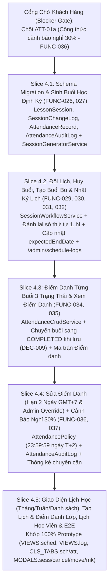

# Phase 4 Implementation Sub-Plan: Module 04 & 05 — Lịch Học, Buổi Học & Điểm Danh (`FUNC-026..032`, `FUNC-034..037`)

> [!NOTE]
> **TRẠNG THÁI THỰC THI (UNBLOCKED — READY FOR EXECUTION):**
> Cổng chờ `ATT-01a` (`FUNC-036`) đã được chốt hoàn tất theo **`DEC-033` (12/11/2026)**: `(absentCount + excusedCount) * 100 >= totalSessions * 30`, UI hiển thị tách biệt `Vắng` và `Có phép`, tỷ lệ chuyên cần (`%`) tính theo `Math.round((presentCount / markedSessionsSinceEnrolled) * 100)`. Toàn bộ Phase 4 sẵn sàng thực thi theo 5 Vertical Slices TDD.

> **Execution Mode:** Thực thi theo quy trình **Superpowers Subagent-Driven Development (SDD)** & **Vertical Slice TDD (`RED -> GREEN -> REFACTOR`)** (`akit-plan`, `akit-implement`) trên nhánh Git Flow `feature/phase-04-schedule-and-attendance` tách từ `develop`.
> **Prior-Art & Architecture Grounding (`akit-prior-art`):** Đã đối chiếu 3 giải pháp mã nguồn mở (`frappe/education`, `calcom/cal.com`, `jkbrzt/rrule`) và quyết định áp dụng chiến lược **Adapt**:
> 1. **Materialized `LessonSession` Rows (từ `frappe/education` & `calcom/cal.com`):** Khởi tạo tường minh các bản ghi buổi học (`LessonSession`) trong PostgreSQL từ lịch định kỳ (`scheduleDays`, `scheduleStartTime`, `scheduleEndTime`, `startDate`, `totalSessions`) thay vì chỉ tính ảo bằng `RRULE` lúc truy vấn, giúp gắn khóa ngoại trực tiếp với điểm danh (`AttendanceRecord`), bài kiểm tra Mini-test (`Phase 6`), buổi học bù (`makeupForSessionId`) và đánh lại số thứ tự buổi (`sessionNumber`) chính xác trong giao dịch `prisma.$transaction`.
> 2. **On-Demand `AttendanceRecord` Materialization (từ `frappe/education`):** Không sinh trước hàng loạt bản ghi điểm danh rỗng cho các buổi tương lai; bản ghi `AttendanceRecord` chỉ được khởi tạo/cập nhật tại thời điểm Giáo viên hoặc Admin bấm **Lưu điểm danh** cho các học viên thuộc danh sách lớp tại ngày diễn ra buổi học (`enrolledDate <= sessionDate && (leftDate == null || leftDate >= sessionDate)`).
> 3. **Timezone-Anchored 2-Day Edit Window (`date-fns-tz` `Asia/Ho_Chi_Minh`):** Sử dụng `isWithinTeacherAttendanceWindow` và `calculateTeacherAttendanceDeadline` đã kiểm chứng tại `timezone.util.ts` (khóa sổ lúc `23:59:59.999` GMT+7 của ngày thứ 2 sau ngày học theo `DEC-032`).

- **Goal:** Xây dựng hoàn chỉnh hệ thống Quản lý Lịch học & Buổi học (`FUNC-026..032`: Khai báo lịch định kỳ, Tự động sinh danh sách buổi học dự kiến, Không tự chuyển `Đã học` khi quên điểm danh `DEC-009`, Xem lịch Tháng/Tuần/Danh sách khớp 100% Prototype, Đổi lịch buổi `FUNC-029`, Hủy buổi bảo toàn dữ liệu `FUNC-030`, Tạo buổi học bù thế chỗ buổi hủy `FUNC-031`, Nhật ký thay đổi lịch bất biến `FUNC-032`) và Quản lý Điểm danh (`FUNC-034..037`: Điểm danh 3 trạng thái `Có mặt / Vắng / Có phép` `DEC-010`, Ma trận điểm danh & Lịch điểm danh cá nhân của Học viên, Tổng hợp số buổi nghỉ `FUNC-036`, và Sửa điểm danh bị nhầm với cửa sổ 2 ngày GMT+7 cho GV + Admin Override Audit Log `DEC-032`).
- **Architecture:** Modular Monolith tuân thủ nghiêm ngặt **Anti-God-File Guardrails** (mọi Backend Service $\le 350$ LOC; mọi Frontend Page $\le 250$ LOC, tách biệt `src/features/{schedules,attendance}/{api,hooks,components}/`) và **khớp 100% bố cục, thẩm mỹ Thư họa Á Đông của Prototype (`prototype/TD Hán Ngữ (Copy).html`)**.
- **Tech Stack:** NestJS 12, Prisma 6.4.1 (PostgreSQL 16 `TIMESTAMPTZ(3)`, `@db.Date`, `onDelete: Restrict`, row-level locking `FOR UPDATE`), `date-fns` + `date-fns-tz` (`Asia/Ho_Chi_Minh`), Next.js 16 (App Router) + Tailwind CSS v4, Vitest, Supertest & Playwright.
- **Parent Spec:** [`MASTER_PLAN.md`](file:///c:/Users/ASUS/Desktop/WebEdu/MASTER_PLAN.md), [`04-lich-buoi-hoc.md`](file:///c:/Users/ASUS/Desktop/WebEdu/TD_Han_Ngu_Project_Context_v1.0/docs/02-requirements/modules/04-lich-buoi-hoc.md), [`05-diem-danh.md`](file:///c:/Users/ASUS/Desktop/WebEdu/TD_Han_Ngu_Project_Context_v1.0/docs/02-requirements/modules/05-diem-danh.md), [`decision-log.md`](file:///c:/Users/ASUS/Desktop/WebEdu/TD_Han_Ngu_Project_Context_v1.0/docs/01-business/decision-log.md), [`open-issues.md`](file:///c:/Users/ASUS/Desktop/WebEdu/TD_Han_Ngu_Project_Context_v1.0/docs/01-business/open-issues.md), [`prototype-review.md`](file:///c:/Users/ASUS/Desktop/WebEdu/TD_Han_Ngu_Project_Context_v1.0/docs/02-requirements/prototype-review.md).

---

## Global Constraints, Security & Business Invariants (6 Cổng Kỹ Thuật AKit)

1. **Strict Type Safety & Anti-God-File Guardrails:**
   - `tsc --noEmit`, `oxlint --type-aware`, `eslint` đạt **0 warnings, 0 errors**. Cấm tuyệt đối `any`, `as any`, `@ts-ignore`, `@ts-expect-error`.
   - Mọi Backend Service trong `backend/src/modules/{schedules,attendance}/services/*.ts` bắt buộc $\le 350$ LOC (`node scripts/check-loc.js`).
   - Mọi Frontend Page trong `frontend/src/app/(portal)/**/page.tsx` bắt buộc $\le 250$ LOC; toàn bộ `useEffect` gọi API phải gắn `AbortController`.
2. **Multi-tenant & Object-Level Authorization (`DEC-024`, `DEC-025`, `DEC-026`, `DEC-031`, `DEC-032`):**
   - **Admin (`Role.ADMIN`):** Có toàn quyền xem tất cả các lớp, buổi học, ma trận điểm danh, nhật ký thay đổi lịch trên toàn trung tâm (`FUNC-012`); là vai trò duy nhất được Tạo/Sửa lịch định kỳ (`FUNC-026`), Thêm buổi thủ công (`FUNC-027`), Đổi lịch buổi (`FUNC-029`), Hủy buổi (`FUNC-030`), Tạo buổi học bù (`FUNC-031`) (`DEC-031`); được Điểm danh (`FUNC-034`, `DEC-026`) và Sửa điểm danh bất kỳ lúc nào kèm nhập lý do vào `AttendanceAuditLog` (`FUNC-037`, `DEC-032`).
   - **Giáo viên (`Role.TEACHER`):**
     - Chỉ xem lịch dạy và buổi học của các lớp mình đang phụ trách (`teacherId === actor.id`) hoặc lớp đã kết thúc mà mình phụ trách cuối cùng ở chế độ `READ_ONLY` (`DEC-025`).
     - Không được tự đổi lịch, hủy buổi hay tạo buổi bù (`403 Forbidden` — `DEC-031`).
     - Được Điểm danh (`FUNC-034`) cho các buổi thuộc lớp mình phụ trách có ngày học $\le$ hôm nay (`Asia/Ho_Chi_Minh`) và chưa bị hủy; được Sửa điểm danh (`FUNC-037`) đến hết `23:59:59.999` (GMT+7) của ngày thứ 2 sau ngày học (`DEC-032`). Quá hạn 2 ngày trả về `403 Forbidden`.
   - **Học viên (`Role.STUDENT`):**
     - Chỉ xem lịch học và trạng thái điểm danh cá nhân của chính mình (`FUNC-010`, `FUNC-028`, `FUNC-035`, `FUNC-036`) trong lớp hiện tại hoặc lớp lịch sử của mình (`FUNC-023`). Không xem được điểm danh của học viên khác trong cùng lớp (`403`/`404` BOLA protection).
   - **Superadmin thuần (`[Role.SUPERADMIN]`):**
     - Không mặc định xem dữ liệu học tập/điểm danh của học viên (`DEC-024`), nhưng được xem Nhật ký thay đổi lịch (`FUNC-032`) phục vụ giám sát vận hành hệ thống.
3. **prototype-review.md & 100% Visual Fidelity Rules:**
   - **Cleanup #9:** Không làm menu/màn hình "Điểm danh riêng với danh sách Buổi gần đây (14 ngày)" cho Giáo viên; Giáo viên và Admin bấm vào buổi học trên Lịch học (`VIEWS.sched`) hoặc Danh sách buổi học trong Chi tiết lớp (`CLS_TABS.sch`) để mở popup chi tiết buổi (`MODALS.sess`) và bấm nút **Điểm danh** ngay tại chỗ.
   - **Cleanup #10 & #11:** Giữ đầy đủ trạng thái tự tính `Hôm nay` (`TODAY`), `Chưa điểm danh` (`MISSED_ATTENDANCE`), `Dự kiến` (`SCHEDULED`), `Đã học` (`COMPLETED`), `Đã hủy` (`CANCELLED`), nhãn `Bù` (`isMakeup`), nhãn `Đổi` (`isRescheduled`), và dòng `Điểm danh: x/y có mặt` trong popup chi tiết buổi Đã học.
   - **Cleanup #6 & #8:** Không hiển thị các nhãn `FUNC-xxx` hay ghi chú "đang chờ chốt" trên giao diện production.

---

## 1. Bảng Trạng Thái Giải Quyết Open Issues Đầu Phase 4 (`SCHED-01`, `ATT-01`)

| Mã Issue | Vấn đề trong `open-issues.md` | Quyết định Đã Chốt / Trạng thái Chờ Khách Hàng |
| :--- | :--- | :--- |
| **`SCHED-01a`** | Ai có quyền sửa lịch định kỳ, đổi lịch buổi, hủy buổi, tạo buổi bù (`FUNC-026, 029, 030, 031`)? | **ĐÃ CHỐT (`DEC-031` — 11/11/2026):**<br>- Chỉ **`ADMIN`** có quyền khai báo/sửa lịch định kỳ (`FUNC-026`), thêm buổi thủ công (`FUNC-027`), đổi lịch buổi (`FUNC-029`), hủy buổi (`FUNC-030`) và tạo buổi học bù (`FUNC-031`).<br>- Giáo viên và Học viên chỉ xem lịch (`FUNC-028`); Giáo viên (lớp phụ trách) và Admin (`DEC-026`) thực hiện điểm danh (`FUNC-034`). |
| **`SCHED-01b`** | Khi hủy buổi mà chưa tạo buổi bù ngay (`FUNC-027, 030, DEC-009`), Tổng số buổi của lớp (`totalSessions`) xử lý thế nào? | **ĐÃ CHỐT (`DEC-031` — 11/11/2026):**<br>- Giữ nguyên `Class.totalSessions`.<br>- Buổi bị hủy chuyển sang `status = CANCELLED`, `sessionNumber = null` (không tính vào số thứ tự buổi và không tính vào số buổi đã học).<br>- Các buổi hoạt động (`status != CANCELLED`) được đánh lại số thứ tự liên tục `1..N` theo thứ tự thời gian (`sessionDate ASC, startTime ASC`). Hệ thống không tự động đẻ thêm buổi ở cuối khóa (`DEC-009`) mà chờ Admin tạo buổi học bù (`FUNC-031`, tối đa 1 buổi bù cho 1 buổi hủy) hoặc thêm buổi thủ công (`FUNC-027`). |
| **`ATT-01b`** | Mốc thời gian tính cửa sổ 2 ngày Giáo viên được sửa điểm danh bị nhầm (`FUNC-037`, `DEC-010`)? | **ĐÃ CHỐT (`DEC-032` — 11/11/2026):**<br>- Giáo viên phụ trách lớp được sửa điểm danh từ ngày diễn ra buổi học (`00:00:00.000` GMT+7) cho đến **hết `23:59:59.999` (múi giờ `Asia/Ho_Chi_Minh`, GMT+7) của ngày thứ 2 sau ngày học** (VD: buổi học ngày `10/11` sửa được đến hết `23:59:59` ngày `12/11`).<br>- Khi sửa điểm danh đã lưu (thay đổi trạng thái của học viên), bắt buộc nhập `reason` và ghi vào `AttendanceAuditLog`. Sau hạn 2 ngày, chỉ `ADMIN` mới sửa được (Admin sửa bất kỳ lúc nào kèm `reason`). |
| **`ATT-01a`** | Công thức tính ngưỡng cảnh báo nghỉ 30% (`FUNC-036`, `DEC-010`):<br>1. Tử số tính chỉ `Vắng không phép` (`ABSENT`) hay cộng cả `Vắng có phép` (`EXCUSED`)?<br>2. Mẫu số là `Tổng số buổi của lớp (totalSessions)` hay `Số buổi đã điểm danh thực tế` của học viên? | **ĐÃ CHỐT (`DEC-033` — 12/11/2026):**<br>- Tử số cộng cả `Vắng không phép` (`ABSENT`) + `Vắng có phép` (`EXCUSED`); trên UI vẫn tách rõ 2 cột/bộ đếm `Vắng` và `Có phép`.<br>- Mẫu số là `Class.totalSessions`, cảnh báo đỏ khi `(absentCount + excusedCount) * 100 >= totalSessions * 30` (VD: 24 buổi $\rightarrow$ từ 8 buổi nghỉ trở lên).<br>- Tỷ lệ chuyên cần (`%`) tính theo `Math.round((presentCount / markedSessionsSinceEnrolled) * 100)`. |

---

## 2. Sơ Đồ Kiến Trúc Thực Thi Theo 5 Vertical Slices



---

## 3. Thiết Kế Cơ Sở Dữ Liệu (Migration `20261111160000_phase04_schedule_and_attendance`)

Bổ sung các enum và 4 bảng mới (`lesson_sessions`, `session_change_logs`, `attendance_records`, `attendance_audit_logs`) vào `backend/prisma/schema.prisma`, đồng thời backfill tự động danh sách buổi học (`lesson_sessions`) cho các lớp học hiện có trong migration để bảo toàn tính nhất quán:

```prisma
enum SessionType {
  REGULAR
  MANUAL
  MAKEUP
}

enum SessionStatus {
  SCHEDULED
  COMPLETED
  CANCELLED
}

enum SessionChangeAction {
  GENERATE
  UPDATE_RECURRING_RULE
  ADD_MANUAL
  RESCHEDULE
  CANCEL
  ADD_MAKEUP
}

enum AttendanceStatus {
  PRESENT
  ABSENT
  EXCUSED
}

model LessonSession {
  id                 String           @id @default(uuid())
  classId            String           @map("class_id")
  sessionNumber      Int?             @map("session_number")
  sessionDate        DateTime         @map("session_date") @db.Date
  startTime          String           @map("start_time") @db.VarChar(5)
  endTime            String           @map("end_time") @db.VarChar(5)
  type               SessionType      @default(REGULAR)
  status             SessionStatus    @default(SCHEDULED)
  isRescheduled      Boolean          @default(false) @map("is_rescheduled")
  isMakeup             Boolean          @default(false) @map("is_makeup")
  makeupForSessionId   String?          @unique @map("makeup_for_session_id")
  topic                String?          @db.VarChar(255)
  cancelReason         String?          @map("cancel_reason") @db.Text
  cancelledById        String?          @map("cancelled_by_id")
  cancelledAt          DateTime?        @map("cancelled_at") @db.Timestamptz(3)
  attendanceMarkedById String?          @map("attendance_marked_by_id")
  attendanceMarkedAt   DateTime?        @map("attendance_marked_at") @db.Timestamptz(3)
  createdAt            DateTime         @default(now()) @map("created_at") @db.Timestamptz(3)
  updatedAt            DateTime         @updatedAt @map("updated_at") @db.Timestamptz(3)

  class              Class            @relation(fields: [classId], references: [id], onDelete: Restrict)
  makeupForSession   LessonSession?   @relation("MakeupSessionLink", fields: [makeupForSessionId], references: [id], onDelete: Restrict)
  makeupReplacement  LessonSession?   @relation("MakeupSessionLink")
  cancelledBy        User?            @relation("SessionCancelledBy", fields: [cancelledById], references: [id], onDelete: SetNull)
  attendanceMarkedBy User?            @relation("SessionAttendanceMarkedBy", fields: [attendanceMarkedById], references: [id], onDelete: SetNull)
  attendanceRecords  AttendanceRecord[]
  attendanceAudits   AttendanceAuditLog[]
  changeLogs         SessionChangeLog[]

  @@index([classId, sessionDate, startTime])
  @@index([sessionDate, status])
  @@map("lesson_sessions")
}

model SessionChangeLog {
  id                String              @id @default(uuid())
  classId           String              @map("class_id")
  sessionId         String?             @map("session_id")
  action            SessionChangeAction
  actorId           String              @map("actor_id")
  actorName         String              @map("actor_name") @db.VarChar(100)
  previousDate      DateTime?           @map("previous_date") @db.Date
  previousStartTime String?             @map("previous_start_time") @db.VarChar(5)
  previousEndTime   String?             @map("previous_end_time") @db.VarChar(5)
  newDate           DateTime?           @map("new_date") @db.Date
  newStartTime      String?             @map("new_start_time") @db.VarChar(5)
  newEndTime        String?             @map("new_end_time") @db.VarChar(5)
  reason            String              @db.Text
  createdAt         DateTime            @default(now()) @map("created_at") @db.Timestamptz(3)

  class   Class          @relation(fields: [classId], references: [id], onDelete: Restrict)
  session LessonSession? @relation(fields: [sessionId], references: [id], onDelete: SetNull)
  actor   User           @relation("SessionChangeActor", fields: [actorId], references: [id], onDelete: Restrict)

  @@index([classId, createdAt(sort: Desc)])
  @@index([action, createdAt(sort: Desc)])
  @@index([createdAt(sort: Desc)])
  @@map("session_change_logs")
}

model AttendanceRecord {
  id          String           @id @default(uuid())
  sessionId   String           @map("session_id")
  classId     String           @map("class_id")
  studentId   String           @map("student_id")
  status      AttendanceStatus
  note        String?          @db.VarChar(255)
  markedById  String           @map("marked_by_id")
  markedAt    DateTime         @default(now()) @map("marked_at") @db.Timestamptz(3)
  updatedById String?          @map("updated_by_id")
  updatedAt   DateTime         @updatedAt @map("updated_at") @db.Timestamptz(3)

  session   LessonSession        @relation(fields: [sessionId], references: [id], onDelete: Restrict)
  class     Class                @relation(fields: [classId], references: [id], onDelete: Restrict)
  student   User                 @relation("StudentAttendanceRecords", fields: [studentId], references: [id], onDelete: Restrict)
  markedBy  User                 @relation("AttendanceMarkedBy", fields: [markedById], references: [id], onDelete: Restrict)
  updatedBy User?                @relation("AttendanceUpdatedBy", fields: [updatedById], references: [id], onDelete: SetNull)
  auditLogs AttendanceAuditLog[]

  @@unique([sessionId, studentId])
  @@index([classId, studentId])
  @@index([studentId, sessionId])
  @@map("attendance_records")
}

model AttendanceAuditLog {
  id                 String           @id @default(uuid())
  attendanceRecordId String           @map("attendance_record_id")
  sessionId          String           @map("session_id")
  classId            String           @map("class_id")
  studentId          String           @map("student_id")
  actorId            String           @map("actor_id")
  actorRole          Role             @map("actor_role")
  oldStatus          AttendanceStatus @map("old_status")
  newStatus          AttendanceStatus @map("new_status")
  oldNote            String?          @map("old_note") @db.Text
  newNote            String?          @map("new_note") @db.Text
  reason             String           @db.Text
  isAdminOverride    Boolean          @default(false) @map("is_admin_override")
  createdAt          DateTime         @default(now()) @map("created_at") @db.Timestamptz(3)

  attendanceRecord   AttendanceRecord @relation(fields: [attendanceRecordId], references: [id], onDelete: Restrict)

  @@index([attendanceRecordId, createdAt(sort: Desc)])
  @@index([classId, createdAt(sort: Desc)])
  @@map("attendance_audit_logs")
}
```

### Quy tắc tính trạng thái hiển thị của Buổi học (`computedDisplayState` — `FUNC-027`, `FUNC-028`, `DEC-009`):
- Trong Database, `LessonSession.status` lưu 3 trạng thái vật lý: `SCHEDULED`, `COMPLETED`, `CANCELLED`.
- Khi trả về qua Mapper (`toSessionItemDto`), hệ thống đối chiếu `sessionDate` với ngày hiện tại theo múi giờ `Asia/Ho_Chi_Minh` (`resolveVnToday()`):
  1. Nếu `status === CANCELLED` $\rightarrow$ `displayStatus = 'CANCELLED'` (`Đã hủy`, màu xám gạch ngang).
  2. Nếu `status === COMPLETED` (tức đã lưu điểm danh `FUNC-034`) $\rightarrow$ `displayStatus = 'COMPLETED'` (`Đã học`, màu xanh lá `--jade`, kèm chỉ số `Điểm danh: x/y có mặt`).
  3. Nếu `status === SCHEDULED`:
     - Nếu `sessionDate === todayVn` $\rightarrow$ `displayStatus = 'TODAY'` (`Hôm nay`, nhãn hổ phách `--amber` / viền đậm).
     - Nếu `sessionDate < todayVn` $\rightarrow$ `displayStatus = 'MISSED_ATTENDANCE'` (`Chưa điểm danh`, nhãn đỏ/cam cảnh báo — **tuyệt đối không tự chuyển sang `COMPLETED`** theo `DEC-009`).
     - Nếu `sessionDate > todayVn` $\rightarrow$ `displayStatus = 'SCHEDULED'` (`Dự kiến`, màu xanh dương `--blue`).

---

## 4. Phân Rã Module Chống "God File" (Anti-God-File Architecture)

### 4.1. Backend (`backend/src/modules/`)
Tách thành 2 module độc lập hoặc các sub-services chuyên biệt (mỗi file $\le 350$ LOC):
1. `backend/src/modules/schedules/` (`SchedulesModule`):
   - `dto/schedules.dto.ts`: `QuerySessionsDto`, `RescheduleSessionDto`, `CancelSessionDto`, `CreateMakeupSessionDto`, `AddManualSessionDto`, `QueryScheduleLogsDto`.
   - `policies/session-schedule.policy.ts`: Thuật toán sinh danh sách ngày học từ `startDate + scheduleDays + totalSessions`, kiểm tra trùng lịch giữa các buổi trong cùng lớp (`Trùng lịch với Buổi [n]`), kiểm tra cảnh báo trùng lịch dạy của Giáo viên ở lớp khác, đánh lại số thứ tự `1..N` cho các buổi không bị hủy, tính lại `Class.expectedEndDate`.
   - `mappers/session.mapper.ts`: Chuyển đổi `LessonSession` $\rightarrow$ `SessionItemDto` (kèm `displayStatus`, `presentCount`, `totalRosterCount`, thông tin buổi gốc nếu là buổi bù hoặc đã đổi lịch) và `SessionChangeLog` $\rightarrow$ `SessionChangeLogDto`.
   - `services/session-generator.service.ts`: Sinh buổi học lần đầu khi tạo lớp (`FUNC-026, 027`) và tái sinh các buổi `SCHEDULED` chưa diễn ra khi Admin sửa lịch định kỳ / tổng số buổi của lớp (`ClassCrudService` gọi trong cùng `$transaction`).
   - `services/session-query.service.ts`: Lấy danh sách buổi học dạng Calendar/List (`GET /api/v1/sessions`, `GET /api/v1/classes/:classId/sessions`), chi tiết buổi học (`GET /api/v1/sessions/:sessionId`), và nhật ký thay đổi lịch (`GET /api/v1/schedule-logs`, `GET /api/v1/classes/:classId/schedule-logs`).
   - `services/session-workflow.service.ts`: Xử lý Đổi lịch buổi (`PATCH /api/v1/sessions/:sessionId/reschedule` — `FUNC-029`), Hủy buổi kèm tùy chọn tạo buổi bù ngay (`POST /api/v1/sessions/:sessionId/cancel` — `FUNC-030, 031`), Tạo buổi học bù độc lập (`POST /api/v1/classes/:classId/makeup-sessions` — `FUNC-031`), Thêm buổi thủ công (`POST /api/v1/classes/:classId/sessions` — `FUNC-027`).
   - `schedules.controller.ts`: Các endpoints RESTful gắn `@Roles()` và kiểm tra quyền qua `ClassAccessService`.
2. `backend/src/modules/attendance/` (`AttendanceModule`):
   - `dto/attendance.dto.ts`: `SaveSessionAttendanceDto` (mảng `{ studentId, status, note }` + `reason?`), `QueryAttendanceCalendarDto`.
   - `policies/attendance.policy.ts`:
     - Kiểm tra điều kiện buổi học được phép điểm danh (`status !== CANCELLED`, `sessionDate <= todayVn`, lớp chưa đóng `READ_ONLY`).
     - Xác định danh sách học viên hợp lệ của buổi học tại ngày `sessionDate` (`rosterOn(classId, sessionDate)` dựa trên `Enrollment.enrolledDate <= sessionDate && (leftDate === null || leftDate >= sessionDate)`).
     - Kiểm tra cửa sổ 2 ngày GMT+7 cho Giáo viên (`isWithinTeacherAttendanceWindow(sessionDate, now)`) và bắt buộc nhập `reason` khi sửa bản ghi điểm danh đã lưu (`FUNC-037`, `DEC-032`).
     - Hàm tính thống kê chuyên cần & cảnh báo nghỉ 30% (`FUNC-036` — sẽ hoàn thiện theo công thức chốt tại `ATT-01a`).
   - `mappers/attendance.mapper.ts`: Chuyển đổi bảng điểm danh buổi học, ma trận Học viên $\times$ Buổi (`CLS_TABS.att`), và lịch điểm danh cá nhân của Học viên (`studentCal`).
   - `services/attendance-crud.service.ts`: Lưu điểm danh lần đầu (`FUNC-034` — đồng thời chuyển `LessonSession.status = COMPLETED`) và cập nhật/sửa điểm danh đã lưu (`FUNC-037` — ghi `AttendanceAuditLog`).
   - `services/attendance-query.service.ts`: Lấy biểu mẫu điểm danh của 1 buổi (`GET /api/v1/sessions/:sessionId/attendance`), ma trận điểm danh của lớp (`GET /api/v1/classes/:classId/attendance-matrix`), lịch điểm danh & thống kê chuyên cần của học viên (`GET /api/v1/students/me/attendance-calendar`, `GET /api/v1/classes/:classId/attendance-stats`).
   - `attendance.controller.ts`: Các endpoints RESTful cho Điểm danh.

### 4.2. Frontend (`frontend/src/`)
Tuân thủ 100% bố cục và CSS/layout của `prototype/TD Hán Ngữ (Copy).html` (mỗi Page $\le 250$ LOC):
1. `frontend/src/features/schedules/`:
   - `api/schedules.api.ts` & `hooks/use-schedules.ts` (có `AbortController`).
   - `components/ScheduleCalendarView.tsx`: Khớp `VIEWS.sched` (Chế độ xem `Tháng | Tuần | Danh sách`, thanh công cụ chọn tháng `Tháng trước / Tháng sau / Hôm nay`, bộ lọc Lớp và Giáo viên, chú giải màu `Dự kiến | Hôm nay | Chưa điểm danh | Đã học | Đã hủy | Bù | Đổi`).
   - `components/SessionDetailModal.tsx`: Khớp `MODALS.sess` (Hiển thị Ngày, Giờ, Giáo viên, Loại buổi, Trạng thái, Lý do hủy / Lịch cũ nếu đổi, dòng `Điểm danh: x/y có mặt`; nút `Hủy buổi` & `Đổi lịch` cho Admin khi buổi ở trạng thái Dự kiến; nút `Điểm danh` cho GV/Admin khi buổi chưa hủy và ngày $\le$ hôm nay).
   - `components/RescheduleSessionModal.tsx`: Khớp `MODALS.move` (`FUNC-029` — chọn Ngày mới không ở quá khứ, Giờ bắt đầu/kết thúc bước 15 phút, Lý do đổi lịch).
   - `components/CancelSessionModal.tsx`: Khớp `MODALS.cancel` (`FUNC-030, 031` — chọn Lý do hủy `Nghỉ lễ / GV bận / Khác`, checkbox `Tạo buổi học bù ngay` mở rộng khung nhập Ngày học bù + Giờ bắt đầu/kết thúc ngay trong modal).
   - `components/CreateMakeupSessionModal.tsx`: Khớp `MODALS.mk` (`FUNC-031` — chọn từ dropdown các buổi `Đã hủy` chưa có buổi bù, chọn ngày/giờ học bù).
   - `components/ScheduleChangeLogTable.tsx`: Khớp `logTable` & `VIEWS.log` (`FUNC-032` — hiển thị Thời gian, Người thao tác, Lớp, Buổi, tag Hành động, Cũ $\rightarrow$ Mới, Lý do; kèm bộ lọc Hành động, Lớp, Từ ngày – Đến ngày).
2. `frontend/src/features/attendance/`:
   - `api/attendance.api.ts` & `hooks/use-attendance.ts` (có `AbortController`).
   - `components/SessionAttendanceModal.tsx` (hoặc Drawer/Panel điểm danh mở trực tiếp khi bấm `Điểm danh` từ `SessionDetailModal` hoặc bảng buổi học — tuân thủ Cleanup #9): Khớp `attForm` (`FUNC-034, 037` — nút `Tất cả có mặt`, bảng STT / Học viên / Segmented Radio 3 trạng thái `Có mặt | Vắng | Có phép` / Ghi chú, ô nhập `Lý do sửa điểm danh` khi chỉnh sửa bản ghi đã lưu, dòng `Cập nhật bởi [Tên] lúc dd/mm/yyyy HH:mm` và biểu tượng lịch sử sửa).
   - `components/ClassAttendanceMatrix.tsx`: Khớp `CLS_TABS.att` (`FUNC-035` — Ma trận Học viên $\times$ Buổi với ký hiệu `✓` Có mặt xanh lá, `✕` Vắng đỏ, `P` Có phép vàng/hổ phách, `·` Chưa vào lớp, và cột tổng hợp buổi nghỉ cuối bảng).
   - `components/StudentAttendanceCalendar.tsx`: Khớp `studentCal` (`FUNC-035, 036` — 4 thẻ thống kê `Tiến độ | Có mặt | Vắng | Dự kiến kết thúc`, bộ chọn lớp hiện tại/lịch sử, lịch tháng tô màu từng buổi `Có mặt | Vắng | Có phép | Chưa diễn ra | Đã hủy`, bấm vào ngày mở modal xem chi tiết buổi & ghi chú của GV).
3. Cập nhật tích hợp vào các Route Pages:
   - `frontend/src/app/(portal)/admin/schedules/page.tsx` & `frontend/src/app/(portal)/teacher/schedules/page.tsx`: Trang Lịch học / Lịch dạy (`VIEWS.sched`).
   - `frontend/src/app/(portal)/admin/schedule-logs/page.tsx`: Trang Nhật ký thay đổi lịch (`VIEWS.log` — hiển thị cho Admin & Superadmin).
   - `frontend/src/app/(portal)/student/schedule/page.tsx`: Trang Lịch & điểm danh của Học viên (`studentCal`).
   - Cập nhật Chi tiết lớp (`ClassDetailView.tsx`): Kích hoạt đầy đủ 2 tab **`Lịch học` (`CLS_TABS.sch`)** và **`Điểm danh` (`CLS_TABS.att`)**, cập nhật thẻ thống kê `Tiến độ`, `Buổi tiếp theo`, `Kết thúc dự kiến` và cột `Số buổi nghỉ / Chuyên cần` trong tab `Học viên` (`CLS_TABS.stu`).

---

## 5. Bảng Kiểm Tra Xung Đột Giao Diện (Pre-Flight Conflict Scan)

| Giao diện / Tài nguyên | Nguồn sản xuất (`Produces`) | Nguồn tiêu thụ (`Consumes`) | Kiểm tra tính tương thích | Trạng thái |
| :--- | :--- | :--- | :--- | :---: |
| `Class.scheduleDays`, `startDate`, `totalSessions`, `expectedEndDate` | Phase 3 (`ClassCrudService`) | Phase 4 (`SessionGeneratorService`, `SessionWorkflowService`) | Khi tạo/sửa lớp ở Phase 3, `SessionGeneratorService` đồng bộ danh sách `LessonSession` và cập nhật `expectedEndDate` theo buổi học cuối cùng chưa bị hủy | **Clean** |
| `Enrollment.enrolledDate`, `leftDate`, `status` | Phase 3 (`ClassEnrollmentService`) | Phase 4 (`AttendancePolicy.resolveSessionRoster`) | Danh sách điểm danh buổi học ngày $D$ lọc học viên có `enrolledDate <= D && (leftDate == null \|\| leftDate >= D)` | **Clean** |
| `isWithinTeacherAttendanceWindow` (`timezone.util.ts`) | Phase 1 (`timezone.util.ts`) | Phase 4 (`AttendancePolicy`) | Đã có sẵn hàm tính hạn `23:59:59.999` GMT+7 của ngày $T+2$ kèm unit test pass 100% | **Clean** |
| `LessonSession.status = COMPLETED` | Phase 4 (`AttendanceCrudService`) | Phase 8 (`CourseProgressService` — `FUNC-071`) | Tiến độ lớp (`done/total`) chỉ đếm buổi có `status === COMPLETED` (đã điểm danh — `DEC-009`) | **Clean** |
| Công thức cảnh báo nghỉ 30% (`FUNC-036`) | Quyết định khách hàng (`ATT-01a`, `DEC-033`) | Phase 4 (`AttendancePolicy`, `CLS_TABS.stu`, `studentCal`) | `(absentCount + excusedCount) * 100 >= totalSessions * 30`, UI tách `Vắng` và `Có phép`, chuyên cần `%` theo `presentCount / markedSessions` | **Clean (`DEC-033`)** |

---

## 6. Chi Tiết Từng Vertical Slice Task (Thực Thi Sau Khi Chốt `ATT-01a`)

### Task 4.1: Schema Migration & Thuật Toán Sinh Buổi Học Định Kỳ (`FUNC-026, 027`)
- **Files:**
  - Modify: `backend/prisma/schema.prisma`
  - Create: `backend/prisma/migrations/20261111160000_phase04_schedule_and_attendance/migration.sql`
  - Create: `backend/src/modules/schedules/policies/session-schedule.policy.ts`
  - Create: `backend/src/modules/schedules/services/session-generator.service.ts`
  - Modify: `backend/src/modules/classes/services/class-crud.service.ts` (gọi `SessionGeneratorService` khi tạo lớp mới hoặc khi sửa lịch học định kỳ / tổng số buổi của lớp)
  - Test: `backend/test/unit/schedules/session-generator.service.spec.ts`
- **TDD Verification (`RED -> GREEN -> REFACTOR`):**
  - Viết unit test kiểm증:
    1. Tạo lớp `startDate = 2026-09-21`, `scheduleDays = [1, 3, 5]`, `totalSessions = 30` $\rightarrow$ sinh đúng 30 bản ghi `LessonSession` ở trạng thái `SCHEDULED`, đánh số `sessionNumber` từ `1..30`, ngày cuối cùng khớp `expectedEndDate`.
    2. Qua ngày học nhưng chưa lưu điểm danh: `status` trong DB giữ nguyên `SCHEDULED`, `displayStatus` trả về `MISSED_ATTENDANCE` (`Chưa điểm danh`), tuyệt đối không tự chuyển sang `COMPLETED` (`DEC-009`).
    3. Khi Admin sửa lịch định kỳ của lớp (`FUNC-026`): chỉ tái sinh các buổi `SCHEDULED` từ hôm nay trở đi, giữ nguyên 100% các buổi đã `COMPLETED`, `CANCELLED` hoặc đã diễn ra trong quá khứ, và ghi 1 bản ghi `UPDATE_RECURRING_RULE` vào `SessionChangeLog`.

### Task 4.2: Nghiệp Vụ Đổi Lịch (`FUNC-029`), Hủy Buổi (`FUNC-030`), Tạo Buổi Học Bù (`FUNC-031`) & Nhật Ký Thay Đổi Lịch (`FUNC-032`)
- **Files:**
  - Create: `backend/src/modules/schedules/dto/schedules.dto.ts`
  - Create: `backend/src/modules/schedules/mappers/session.mapper.ts`
  - Create: `backend/src/modules/schedules/services/session-workflow.service.ts`
  - Create: `backend/src/modules/schedules/services/session-query.service.ts`
  - Create: `backend/src/modules/schedules/schedules.controller.ts`
  - Create: `backend/src/modules/schedules/schedules.module.ts`
  - Test: `backend/test/unit/schedules/session-workflow.service.spec.ts`
- **TDD Verification (`RED -> GREEN -> REFACTOR`):**
  - Viết unit & RBAC test kiểm chứng:
    1. Giáo viên hoặc Học viên gọi API Đổi lịch / Hủy buổi / Tạo buổi bù $\rightarrow$ bị chặn `403 Forbidden` (`DEC-031`).
    2. Đổi lịch buổi (`FUNC-029`): chỉ cho phép buổi `SCHEDULED`, không chọn ngày quá khứ, không trùng ngày giờ với buổi khác của cùng lớp; lưu `isRescheduled = true` (lịch cũ tra cứu qua `SessionChangeLog` `RESCHEDULE` và hiển thị qua `previousScheduleText`), đánh lại `sessionNumber` theo thứ tự ngày mới, cập nhật `Class.expectedEndDate`, ghi `SessionChangeLog` (`RESCHEDULE`).
    3. Hủy buổi (`FUNC-030`, `DEC-031`): chỉ cho phép buổi `SCHEDULED`, chuyển `status = CANCELLED`, `sessionNumber = null`, giữ nguyên `Class.totalSessions`, đánh lại `sessionNumber` `1..N` cho các buổi còn lại, không tự sinh buổi mới nếu không tích chọn tạo buổi bù (`DEC-009`), ghi `SessionChangeLog` (`CANCEL`).
    4. Tạo buổi học bù (`FUNC-031`, `DEC-009`): bắt buộc gắn với 1 buổi `CANCELLED` chưa có buổi bù (`@unique makeupForSessionId`), kiểm tra trùng lịch với buổi khác của lớp (`Trùng lịch với Buổi [n]`), tạo buổi `type = MAKEUP`, đánh lại `sessionNumber` sao cho tổng số buổi hoạt động giữ nguyên không cộng trùng, cập nhật `Class.expectedEndDate`, ghi `SessionChangeLog` (`ADD_MAKEUP`).

### Task 4.3: Nghiệp Vụ Điểm Danh Từng Buổi 3 Trạng Thái (`FUNC-034`) & Xem Điểm Danh Theo Lịch / Ma Trận (`FUNC-035`)
- **Files:**
  - Create: `backend/src/modules/attendance/dto/attendance.dto.ts`
  - Create: `backend/src/modules/attendance/policies/attendance.policy.ts`
  - Create: `backend/src/modules/attendance/mappers/attendance.mapper.ts`
  - Create: `backend/src/modules/attendance/services/attendance-crud.service.ts`
  - Create: `backend/src/modules/attendance/services/attendance-query.service.ts`
  - Create: `backend/src/modules/attendance/attendance.controller.ts`
  - Create: `backend/src/modules/attendance/attendance.module.ts`
  - Test: `backend/test/unit/attendance/attendance-crud.service.spec.ts`
- **TDD Verification (`RED -> GREEN -> REFACTOR`):**
  - Viết unit & BOLA test kiểm chứng:
    1. Chỉ Giáo viên đang phụ trách lớp hoặc Admin (`DEC-026`) mới lưu được điểm danh; Giáo viên lớp khác hoặc GV cũ đã bị thay thế nhận `403 Forbidden`.
    2. Chặn điểm danh cho buổi ở tương lai (`sessionDate > todayVn`) hoặc buổi `CANCELLED` (`400 BadRequest`).
    3. Danh sách học viên cần điểm danh của buổi học chỉ gồm các học viên thuộc lớp tại ngày `sessionDate` (`enrolledDate <= sessionDate <= leftDate`), và bắt buộc gửi đủ trạng thái (`PRESENT | ABSENT | EXCUSED`) cho tất cả học viên trong danh sách đó.
    4. Khi lưu điểm danh thành công: `LessonSession.status` chuyển sang `COMPLETED`, ghi nhận `attendanceMarkedAt` và `attendanceMarkedById`.
    5. Học viên A gọi API xem lịch điểm danh chỉ thấy dữ liệu của chính Học viên A, không lộ dữ liệu của Học viên B (`FUNC-010`, `FUNC-035`).

### Task 4.4: Sửa Điểm Danh (Cửa Sổ 2 Ngày GMT+7 & Admin Override Audit Log — `FUNC-037`, `DEC-032`) & Tổng Hợp Nghỉ 30% (`FUNC-036`)
- **Files:**
  - Modify: `backend/src/modules/attendance/policies/attendance.policy.ts`
  - Modify: `backend/src/modules/attendance/services/attendance-crud.service.ts`
  - Modify: `backend/src/modules/attendance/services/attendance-query.service.ts`
  - Test: `backend/test/unit/attendance/attendance-window-and-audit.spec.ts`
- **TDD Verification (`RED -> GREEN -> REFACTOR`):**
  - Viết unit test kiểm chứng biên thời gian GMT+7 (`Asia/Ho_Chi_Minh`):
    1. Buổi học ngày `2026-11-10`:
       - Lúc `2026-11-12 23:59:59.000 +07:00` (`16:59:59.000Z`): Giáo viên phụ trách lớp sửa điểm danh (kèm `reason`) $\rightarrow$ **Thành công (`200 OK`)**, lưu `AttendanceAuditLog` (`isAdminOverride = false`).
       - Lúc `2026-11-13 00:00:00.000 +07:00` (`17:00:00.000Z` ngày `12/11` UTC): Giáo viên sửa điểm danh $\rightarrow$ **Bị chặn `403 Forbidden`** (`Quá thời hạn 2 ngày cho phép giáo viên chỉnh sửa điểm danh`).
       - Cùng thời điểm quá hạn đó, `Admin` sửa điểm danh kèm `reason` $\rightarrow$ **Thành công (`200 OK`)**, lưu `AttendanceAuditLog` (`isAdminOverride = true`, `oldStatus`, `newStatus`, `reason`).
    2. Nếu sửa trạng thái điểm danh đã lưu mà bỏ trống `reason` $\rightarrow$ trả về `400 BadRequest` (`Vui lòng nhập lý do chỉnh sửa điểm danh`).
    3. Kiểm chứng công thức tổng hợp số buổi nghỉ và cờ cảnh báo 30% (`FUNC-036`) theo đúng quy tắc khách hàng chốt tại `ATT-01a`.

### Task 4.5: Giao Diện Lịch Học, Điểm Danh Trực Tiếp Trên Buổi Học, Nhật Ký Thay Đổi Lịch & E2E Verification
- **Files:**
  - Create: `frontend/src/features/schedules/{api,hooks,components}/*`
  - Create: `frontend/src/features/attendance/{api,hooks,components}/*`
  - Create/Update: `frontend/src/app/(portal)/admin/schedules/page.tsx`, `frontend/src/app/(portal)/admin/schedule-logs/page.tsx`, `frontend/src/app/(portal)/teacher/schedules/page.tsx`, `frontend/src/app/(portal)/student/schedule/page.tsx`
  - Modify: `frontend/src/features/classes/components/ClassDetailView.tsx` (kích hoạt tab `Lịch học` & `Điểm danh`, số liệu tiến độ & chuyên cần thực tế)
  - Modify: `frontend/src/components/portal/PortalSidebar.tsx` (đảm bảo menu điều hướng của Học viên, Giáo viên, Admin khớp Prototype và không có menu Điểm danh rời theo Cleanup #9)
- **Verification:**
  - Chạy `node scripts/check-loc.js`, `npm --prefix frontend run typecheck`, `npm --prefix frontend run lint`, `npm --prefix backend test`, `npm --prefix backend run test:e2e`.
  - Kiểm tra trực quan trên trình duyệt đối chiếu 100% với `prototype/TD Hán Ngữ (Copy).html`.
  - Thực hiện Independent Review qua `akit-critic` và `akit-security`.
